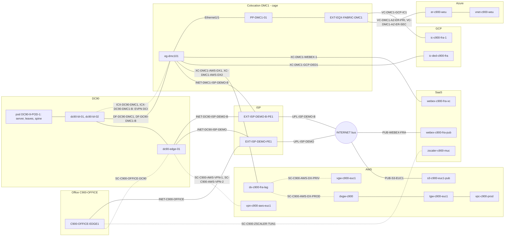

# Full topology: sample data (DC, colocation, cloud, SaaS, office, internet)

Branch `model/cloud-saas`, instance `http://localhost:8100` (token `06438eb2-8019-4776-878c-0941b1f1d1ec`), Infrahub
branch `main`. The data is hand-written: no generator, transform or check runs. It loads on the bootstrap data alone
(it does not depend on `30_all`). It is ONE topology in one directory; the numbered folders are the load order.

## Folder map

One kind per file: the top-level `spec.kind` of a file is the object a reader looks for (a device, a circuit, a
segment, a BGP process). What exists only for that object is nested under it: the interfaces, LAG and peerings of a
device or transport (`interfaces:`), the front ports of a patch panel (`front_ports:`), the gateway address and prefix of
a segment, the loopback that is a BGP process's router id, the provider's `peer_ip` of a peering. What cannot be nested
stays in a flat file of its own kind, because it names something created later (a sub-interface names the VRF, which
lists the device as a member; a port-channel names the segment, which needs the leaf's SVI first) or because two parents
use it (a link prefix, an AS number). Folders and files are numbered so that the sorted path order is the dependency
order (`infrahubctl object load` of the directory runs them one after the other).

| Folder | What it holds | Depends on |
| ------ | ------------- | ---------- |
| `00_common/` | providers, the customer C900, AS numbers, the shared prefixes (links, VPC block, loopback ranges), BGP keys (`00`-`04`) | bootstrap |
| `01_dc/00_site/` | metro, building, suite and the first rack, DC90, pod `DC90-9-POD-1` (design `S_MIDDLE`), the racks of the pod, the ISP facility `ISP-DEMO` | `00_common` |
| `01_dc/01_physical/` | patch panels with their front ports, devices (the edge `dc90-edge-01` has the internet access, the AWS VPN tunnels and the end of the office tunnel as nested interfaces; it has NO cloud legs; the server nests its bond), cables | `00_site` |
| `01_dc/02_routing/` | AS numbers of the pod, the VRF, the SVIs, the BGP processes (loopbacks nested), the EVPN overlay sessions | `01_physical` |
| `01_dc/03_tenant/` | the footprint of C900, the segment `c900-demo-web-p` (gateway and prefix nested), the vPC port-channels, the segment port, the MLAG | `02_routing` |
| `02_colo/` | `00_site` colocation `COLO-DEMO` / metro `DMC` / ONE zone (cage) `DMC1`, building and rack; `01_physical` patch panel `PP-DMC1-01`, the cage edge `eg-dmc101` and the provider's Fabric port `EXT-EQX-FABRIC-DMC1`, cables; `02_routing` VRF, sub-interfaces of the cloud legs, overlay process; `03_dci` two dark fibres DC - cage, DCI circuits and EVPN sessions | `01_dc` |
| `03_cloud/` | `00_regions`, `01_network` (accounts, VPC/VNet, IPsec profile, gateways, route tables, attachments), `02_tenant` (footprints, segments, instance, S3 endpoint), `03_transport` (Direct Connect, ExpressRoute, Interconnect, VPN with ports, bundle and peerings nested), `04_circuits` (the carriers end in the cage `DMC1`, session circuits, BGP sessions of the cage edge) | `02_colo` |
| `04_saas/` | Webex (cross-connect in the cage + BGP) and Zscaler (tunnel): SaaS regions, transports with ports and peerings nested, circuits, sessions, service endpoint | `02_colo`, `03_cloud` |
| `05_office/` | the customer office C900 (`C900-OFFICE`), its SD-WAN edge `C900-OFFICE-EDGE1` (tunnel interfaces nested) and two `tunnel` circuits: to the DC edge and to Zscaler | `04_saas` |
| `06_internet/` | `00_addressing` (AS, transit prefixes), `01_providers` (the second ISP and its router, the public sides of SaaS and cloud, the public service endpoints), `02_circuits` (ports with their transit addresses, the internet carriers of the DC, the cage and the office), `03_routing` (the eBGP session to the ISP) | `01_dc`, `02_colo`, `03_cloud`, `04_saas`, `05_office` |

The sixth folder `06_internet` and the shared `00_common` were not on the owner's list (DC, Colo, Cloud, SaaS, Office):
the internet (ISP, INTERNET, public sides) is none of the five kinds of objects, and the customers, AS and addressing
are shared by several of them. The office comes after SaaS because its `tunnel` circuit ends on the Zscaler transport;
the internet comes after the office because the office's access to its ISP is in
`06_internet/02_circuits/01_carrier_circuits.yml`. The pod `DC90-9-POD-1` holds the spine, the two leaves and the
server; the border leaves and the edge stay at DC level (a border role belongs to the DC).

## The topology: three sites, the internet and the cloud

The sample has three sites from which a path can be traced to every other one, to INTERNET and to the cloud or SaaS:
the office (`C900-OFFICE-EDGE1`), the colocation cage (`eg-dmc101`) and the DC (the segment `c900-demo-web-p` in the
pod, the edge `dc90-edge-01`). The cloud and SaaS do NOT hang on the DC edge: Direct Connect, ExpressRoute and Webex end
in the cage, as in reality.

Links between the sites, the cloud and SaaS (a solid line is a cable or a carrier, a dashed line is a tunnel or a
session; the label is the name of the carrier, circuit or cable from the data; the pod and racks of the DC are in the
second diagram below):



The diagram shows that the cloud and SaaS (Direct Connect, ExpressRoute, GCP, Webex) end in the cage and not on the DC
edge; the DC edge has only the internet access, the tunnels (office, AWS VPN) and the dark fibres to the cage through
the border leaves.

Inside DC90 (suite `DMO-1-Suite-1`, row 1; the pod `DC90-9-POD-1` spans racks 2-5, rack 1 is the border rack and
belongs to the DC; a cable label is its name from the data):

```mermaid
flowchart LR
  subgraph POD["pod DC90-9-POD-1"]
    subgraph R2["rack DMO-1-S1-R1-2: compute"]
      SRV["dc90-srv-01: bond0 eno1, eno2"]
      PP2["PP-DC90-02"]
    end
    subgraph R3["rack DMO-1-S1-R1-3: leaf 1"]
      PP3["PP-DC90-03"]
      L1["dc90-leaf-01"]
    end
    subgraph R4["rack DMO-1-S1-R1-4: leaf 2"]
      PP4["PP-DC90-04"]
      L2["dc90-leaf-02"]
    end
    subgraph R5["rack DMO-1-S1-R1-5: spine"]
      SP["dc90-spine-01"]
    end
  end
  subgraph R1["rack DMO-1-S1-R1-1: border, outside the pod"]
    PP1["PP-DC90-01"]
    BL1["dc90-bl-01"]
    BL2["dc90-bl-02"]
    EDGE["dc90-edge-01"]
  end
  SRV ---|"CBL-DC90-SRV01-ENO1-PP02-F1"| PP2
  PP2 ---|"CBL-DC90-PP02-R1-PP03-F1"| PP3
  PP3 ---|"CBL-DC90-PP03-R1-LEAF01"| L1
  SRV ---|"CBL-DC90-SRV01-ENO2-PP02-F2"| PP2
  PP2 ---|"CBL-DC90-PP02-R2-PP04-F1"| PP4
  PP4 ---|"CBL-DC90-PP04-R1-LEAF02"| L2
  L1 ---|"CBL-DC90-LEAF01-LEAF02-PEER"| L2
  L1 ---|"CBL-DC90-LEAF01-SPINE01"| SP
  L2 ---|"CBL-DC90-LEAF02-SPINE01"| SP
  SP ---|"CBL-DC90-SPINE01-BL01"| BL1
  SP ---|"CBL-DC90-SPINE01-BL02"| BL2
  L1 ---|"CBL-DC90-LEAF01-PP01-F1"| PP1
  PP1 ---|"CBL-DC90-PP01-R1-EDGE01"| EDGE
  BL1 ---|"CBL-DC90-BL01-PP01-F2"| PP1
  PP1 ---|"CBL-DC90-PP01-R2-EDGE01"| EDGE
  BL2 ---|"CBL-DC90-BL02-EDGE01"| EDGE
```



Internet access of each site (every ISP router has an uplink to `INTERNET:bus`, rule I3):

```text
                         THE INTERNET (INTERNET:bus)
                  UPL-ISP-DEMO                        UPL-ISP-DEMO-B
                       |                                    |
             EXT-ISP-DEMO-PE1                       EXT-ISP-DEMO-B-PE1
            et-0/0/0     et-0/0/1                  et-0/0/0     et-0/0/1
               |            |                         |            |
   INET-DC90-ISP-DEMO  INET-C900-OFFICE   INET-DC90-ISP-DEMO-B  INET-DMC1-ISP-DEMO-B
               |            |                         |            |
    dc90-edge-01 Eth1/2   C900-OFFICE-EDGE1 GE1   dc90-edge-01 Eth1/1   eg-dmc101 Eth1/14
```

The shortest paths between the sites (L1 = cables and carriers, L3 = BGP, session circuits, tunnels; details in the
golden files `tests/traversal/golden/`):

| Pair | L1 | L3 |
| ---- | -- | -- |
| office - DC | `GE1` - `INET-C900-OFFICE` - `EXT-ISP-DEMO-PE1` - `INET-DC90-ISP-DEMO` - `dc90-edge-01` - DC panel - leaf - segment | tunnel `SC-C900-OFFICE-DC90` to `dc90-edge-01`, overlay process, leaf, segment |
| office - colocation | `INET-C900-OFFICE` - ISP-DEMO - `UPL-ISP-DEMO` - `INTERNET:bus` - `UPL-ISP-DEMO-B` - ISP-DEMO-B - `INET-DMC1-ISP-DEMO-B` - `eg-dmc101` | tunnel to the DC edge, border leaf, EVPN DCI session to `eg-dmc101` |
| colocation - DC | `eg-dmc101` - `DF-DC90-DMC1` (or `-B`) - border leaf - spine - leaf - segment | EVPN DCI session to the border leaf, edge / spine, leaf, segment |
| DC, colocation, office - INTERNET | its own access carrier (`internet`), ISP router, `UPL-*` carrier, `INTERNET:bus` | not applicable (INTERNET does not route) |
| office - AWS | L1: office access - internet - cage access - `XC-DMC1-AWS-DX1/2` - Direct Connect | tunnel to the DC edge and AWS VPN to the transit gateway |
| colocation - cloud | `eg-dmc101` - carrier - transport port (AWS: directly; Azure and GCP Partner: panel and Fabric port) | sub-interface, handoff circuit, cloud peering |

## Shared vocabulary for all clouds

Operators differ in vocabulary, not in structure. The model has shared elements; the operator's word (VIF, peering,
VLAN attachment, tunnel) appears only in object names, descriptions and in the table below.

| Shared element | Kind | What it is |
| -------------- | ---- | ---------- |
| transport | `CloudDirectConnect` (`physical` / `logical`, `rides_on`), `CloudVPNConnection` (generic `CloudTransport` + `DcimDevice`) | a device that HOLDS INTERFACES: ports (`DcimPhysicalInterface`), a bundle (`DcimLAGInterface`) and peerings; `physical`: ports and bundle in the provider's region, `logical`: a circuit on a partner's or our own port, `CloudVPNConnection`: holds tunnels; the account, `region` or `saas_region`, `owner` (SaaS) are on the transport |
| peering ("cloud interface") | `CloudPeeringInterface` (`DcimInterface` of the transport) | the L3/BGP termination on the cloud side: an interface of the transport riding on its port or bundle (`parent_interface`); a session circuit ends on it (`capabilities`); the provider's address and AS are `peer_ip`, `peer_asn` |
| gateway | `CloudGateway`, `gateway_type`: `hub` / `edge` / `customer` | `hub`: a routing node with attachments and tables; `edge`: where a peering or VPN lands before the network; `customer`: our side of the VPN (public address and AS), required on a VPN connection |
| gateway attachment | `CloudGatewayAttachment` | one connection of a gateway (`gateway`) with EXACTLY one target: `virtual_network` or `peer_gateway` (check R1); `allowed_prefixes`: what it announces towards on-prem |
| routing table | `CloudGatewayRouteTable` | the routing domain of a hub; an attachment has `associated_route_table` and `propagates_to_route_tables` |
| virtual network | `CloudVirtualNetwork` | VPC / VNet; `peers` (symmetric) is network peering |
| service endpoint | `CloudServiceEndpoint` | a private network path to a service (`access`: `address` or `route`) |

Our side is always a sub-interface of a device and our BGP process; it is not in the cloud objects.

`CloudPeeringInterface` (HFID: `[transport, interface]`, for example `[dx-c900-fra-lag, lag1.1000]`): it is a
`DcimInterface`, so it has `device` (the transport), `name`, `mtu` (9000 by default) and `capabilities` like any port.
Its own fields: `scope` (private, public, saas), `routing` (bgp, static), `vlan_id` or `tunnel_index`, `bfd`,
`service_id`; a tunnel: `endpoint_ip`, `tunnel_mode` (ipsec, gre), `crypto_profile` (`SecurityIPsecProfile`),
`tunnel_key` (`RoutingPassword`, the IPsec key; BGP uses `auth`); relationships `parent_interface` (a port or bundle of
the SAME transport; the `DcimSubInterface` marker, the same `sub__interface` edge as a device sub-interface: the port
and the bundle see the peering in `sub_interfaces`, and the peering has an `ip_address`), `gateway` (empty for a VPN
tunnel: it lands through `transport.gateway`), `auth` (`RoutingPassword`), `advertised_prefixes`, and `peer_ip`,
`peer_asn` from `TopologyConnectorRouting`. The account, region and `owner` belong to the transport, not to the peering.

Prefixes have one list per direction: `peering.advertised_prefixes` (US -> cloud; public only, verified by the
provider, and static; empty for `private`) and `attachment.allowed_prefixes` (cloud -> US; empty = the CIDR blocks of
the network). `Gateway.announced_prefixes` does not exist: allowed prefixes are per association, not per gateway.

## Blueprint table per operator

`OrganizationProvider.connection_profile` (aws, azure, gcp, oci, ibm, alibaba, ...) says which blueprint applies. A
cell: the shared element, with the operator's word in parentheses.

| Operator word | Shared element |
| ------------- | -------------- |
| AWS dedicated connection / ExpressRoute Direct port / Dedicated Interconnect / OCI cross-connect / IBM Dedicated / Alibaba physical connection | `CloudDirectConnect` `physical` |
| AWS LAG / ExpressRoute Direct pair / OCI cross-connect group / Interconnect bundle | ONE `CloudDirectConnect` `physical` with the member ports (`DcimPhysicalInterface`) and a bundle (`DcimLAGInterface`, `member_interfaces`); the peering rides on the bundle |
| AWS hosted connection / ExpressRoute circuit (provider) / Partner Interconnect attachment / OCI VC (partner) / IBM Connect / Alibaba hosted | `CloudDirectConnect` `logical` + `partner_account`, `service_key` |
| ExpressRoute circuit on Direct, OCI VC on its own CCG, Dedicated Interconnect attachment | `CloudDirectConnect` `logical` + `rides_on` the transport that holds the port or bundle; its own pair of ports (`msee-pri`, `msee-sec`) for the carriers |
| Dedicated Interconnect / OCI FastConnect: a routed port without a VLAN | `CloudDirectConnect` `physical` with a port; the peering WITHOUT `vlan_id`, `parent_interface` = the port; our end is a PHYSICAL port with an address |
| Equinix Fabric / Megaport VXC | a `virtual_connection` carrier; the end in the cloud = a `logical` transport + `partner_account`; MCR / Network Edge = `CloudNetworkAppliance` |
| AWS VIF private / transit / public, ExpressRoute private / Microsoft peering, GCP VLAN attachment, OCI virtual circuit, IBM, Alibaba VBR | `CloudPeeringInterface` `scope` private or public (+ `vlan_id`, `peer_ip`, `peer_asn`, `auth`) |
| Public VIF / Microsoft peering / OCI public VC: our public prefixes | `peering.advertised_prefixes` (US -> cloud) |
| Webex, M365 over ER, Salesforce over Fabric, Zscaler | a transport with `saas_region` and `owner`, no account (`CloudDirectConnect` with a port or `CloudVPNConnection` without `customer_gateway`) + `CloudPeeringInterface` `scope: saas` (`service_id`) |
| AWS S2S tunnel / Azure VPN / GCP HA VPN tunnel / OCI IPSec tunnel | `CloudPeeringInterface` (`tunnel_index`, `endpoint_ip`, `tunnel_mode`, `crypto_profile`, `tunnel_key`) |
| AWS VPN connection / Azure connection / OCI IPSec connection / IBM VPN connection | `CloudVPNConnection` (`customer_gateway`, `gateway`) |
| AWS customer gateway / Azure local network gateway / GCP peer VPN gateway / OCI CPE | `CloudGateway` `customer` (`ip_address`, `asn`) |
| Zscaler / Netskope / Cloudflare GRE | peering `saas`, `routing: static`, `tunnel_mode: gre`, `endpoint_ip` |
| AWS Transit Gateway / Azure vWAN hub / GCP NCC hub / OCI DRG / IBM Transit Gateway / Alibaba CEN Transit Router | `CloudGateway` `hub` (global: no `region`) |
| AWS Direct Connect Gateway / virtual private gateway / Azure ER gateway, VPN gateway / GCP Cloud Router / Alibaba VBR | `CloudGateway` `edge` |
| TGW route table + association (1) + propagation (N) / vWAN hub route table / DRG route table | `CloudGatewayRouteTable` + `associated_route_table`, `propagates_to_route_tables` |
| TGW VPC attachment / hub VNet connection / NCC VPC spoke / DRG VCN attachment / VGW or Cloud Router in the network | `CloudGatewayAttachment` `gateway` + `virtual_network` |
| DXGW association with TGW or VGW (allowed prefixes) / ER gateway in a hub / TGW peering / DRG RPC / hub-hub | `CloudGatewayAttachment` `gateway` + `peer_gateway` (+ `allowed_prefixes`) |
| TGW VPN attachment, NCC hybrid spoke, DRG IPSec attachment | `CloudVPNConnection.gateway` = hub (no attachment) |
| TGW Connect (GRE), GCP router appliance, vWAN NVA, IBM GRE | peering `private`, `gateway` = hub, `tunnel_mode: gre` |
| VPC peering / VNet peering / local peering | `CloudVirtualNetwork.peers` |
| AWS interface endpoint / Azure private endpoint / GCP PSC | `CloudServiceEndpoint` `access: address` |
| AWS gateway endpoint / OCI service gateway / Azure service endpoint / GCP Private Google Access | `CloudServiceEndpoint` `access: route` |
| AWS / GCP / Azure / OCI / IBM subnet | `CloudNetworkSegment` `cloud_subnet` |

## Object map

| Kind | Role | Example |
| ---- | ---- | ------- |
| `TopologyCarrierCircuit` | physics: wire, cross-connect, virtual connection, internet; the ends are `capabilities` (our port and the transport's port) | `XC-DMC1-AWS-DX1`, `DF-DC90-DMC1`, `INET-DC90-ISP-DEMO` |
| `TopologySessionCircuit` | virtual: handoff / vpn / tunnel; the ends are `capabilities` (our sub-interface or routed port and the transport's peering) | `SC-C900-AWS-DX-PROD`, `SC-C900-GCP-DED` |
| `CloudDirectConnect` | transport-device: ports, bundle (LAG) and peerings; logical: `service_key`, `partner_account`, `rides_on` | `dx-c900-fra-lag`, `er-c900-weu`, `ic-c900-fra-1`, `ic-ded-c900-fra`, `webex-c900-fra-xc` |
| `DcimPhysicalInterface`, `DcimLAGInterface` | ports and bundle of a transport (`device` = the transport) | `dxcon-1a`, `dxcon-1b`, `lag1`, `msee-pri`, `ic-dedicated-port` |
| `SecurityIPsecProfile` | IKE/ESP parameters of a tunnel, one profile for many tunnels | `IPSEC-AES256-SHA256-DH14` |
| `CloudVPNConnection` | a transport without ports: holds the tunnels (interfaces); SaaS: `saas_region` and `owner` | `vpn-c900-aws-euc1`, `zscaler-c900-muc` |
| `CloudPeeringInterface` | the BGP termination in the cloud, an interface of the transport | `lag1.1000`, `er-c900-weu-pri`, `gcp-c900-vlan-att-1`, `gcp-c900-ded-1`, `Tunnel1`, `webex-c900-fra` |
| `CloudGateway` | hub, edge gateway, customer gateway | `tgw-c900-euc1` (hub), `dxgw-c900`, `vgw-c900-euc1`, `ergw-c900-weu`, `cr-c900-euw3` (edge), `cgw-c900-dc90` (customer) |
| `CloudGatewayAttachment`, `CloudGatewayRouteTable` | gateway connections and the routing domain of a hub | `tgwa-c900-vpc`, `tgwa-c900-dxgw`, `rt-c900-prod` |
| `CloudVirtualNetwork` | a virtual network; `peers` | `vpc-c900-prod`, `vnet-c900-weu` + `vnet-c900-weu-spoke` |
| `CloudServiceEndpoint` | a private path to a service | `vpce-c900-s3`, `vpce-c900-webex` |

Removed: `CloudVirtualInterface`, `TopologySaasConnection` (their facts are in `CloudPeeringInterface`),
`TopologyProviderConnection` (owner's decision: the service request is ignored for now; nothing binds a leg, because
the circuits and their `capabilities` do) and `CloudTransitGateway` (it is a `CloudGateway` of type `hub`).

A circuit ends on interfaces through ONE edge, `capabilities` (the shared edge `ManagedGenericInterfaces.capabilities`,
peer `DcimInterface`, min 1, max 2 on every circuit). An interface has only `capabilities` as a circuit edge; there is
no `endpoints` field, no `TopologyCircuitEnd` generic and no `far_end`. An end in an object file is the HFID of the
interface `[device, interface]`: `["eg-dmc101", "Ethernet1/3"]`, `["dx-c900-fra-lag", "dxcon-1a"]`. So the objects must
exist earlier, and the files load alphabetically and in order: `03_cloud/01_network` (accounts, gateways) ->
`03_transport` (the transports, each with its ports, bundle and peerings nested, in that order) -> `04_circuits`
(carriers, session circuits, hand-written BGP sessions), then the same in `04_saas`. Dependent objects are in a later
file because the HFID index of objects from the same run can lag.

The BGP sessions of the cloud legs are hand-written (`03_cloud/04_circuits/02_bgp_sessions.yml`, `04_saas/05_bgp_sessions.yml`: our
sub-interface or routed port in `capabilities`, our process); no generator builds them, and `add_virtual_circuit` is not
to build sessions for a circuit whose end is a cloud peering.

The check `checks/cloud_connection.py` (`validate_cloud_connection`, query `cloud_connection`) holds what the schema
cannot (the server accepts an attachment without a target, with two targets, a `rides_on` loop and a peering riding on
the port of another device): R1 an attachment has exactly one target, R2 a routing table belongs to the hub and to the
attachment's gateway, R3 `rides_on` without a loop, physical only on physical, logical on our transport without
`partner_account`, R4 the segments of a service endpoint are from its network and a tunnel key requires IPsec, R5 a
crypto profile only with IPsec, R6 a VPN tunnel has `endpoint_ip` and is an interface of a `CloudVPNConnection`, R7
withdrawn (the server holds the bundle's members, `checks/interface_parents.py` holds the peering's `parent_interface`),
R8 a peering with `vlan_id` rides on a port or bundle, the parent of a peering is a port or bundle, the VLANs of one
parent are different (the same VLAN on two ports is allowed: ExpressRoute), R9 the place of a transport: exactly one of
`region` and `saas_region`, with an account without `owner`, without an account with `saas_region` and `owner`; a
peering is an interface of the transport, and `scope: saas` lies on a transport with `saas_region`.

## Pools (a convention, no fields)

There are no pool fields. The convention: our address is a /31 (a /30 for a tunnel pair) from `Handoff-<namespace>-IPv4`
(the `ip_namespace` of the session circuit), our private AS from `PRIVATE-ASN32`; a provider that assigns the range
itself (Azure /30, GCP /29, AWS VPN 169.254/30) gives it as the circuit's `link_prefix`. An object file cannot draw from
a pool, so the allocated values are hard-coded: our address in the sub-interface (`02_colo/02_routing/01_virtual_interfaces.yml`), our AS in the
BGP process's `local_as`, the provider's address and AS in the peering's `peer_ip` and `peer_asn`
(nested in the transport, `03_cloud/03_transport/00_direct_connects.yml`).

## Scenario coverage

Full = in the model and in the data; partial = a field exists but simplified; none = not modelled.

| Scenario | Coverage | Notes |
| -------- | -------- | ----- |
| AWS DX dedicated, transit VIF -> DX Gateway -> TGW -> VPC | full | `dx-c900-fra-lag`, `lag1.1000` (scope `private`), `dxgw-c900` (edge) -> `tgwa-c900-dxgw` (`allowed_prefixes 10.200.0.0/16`) -> `tgw-c900-euc1` (hub) -> `tgwa-c900-vpc` |
| AWS DX, private VIF -> VGW -> VPC | full | `lag1.1100`, `vgw-c900-euc1` |
| AWS DX hosted (partner account), LAG | full | `partner_account` (GCP Partner Interconnect); LAG: one transport `dx-c900-fra-lag` with ports `dxcon-1a/1b` and bundle `lag1`, two carriers `XC-DMC1-AWS-DX1/2` |
| GCP Dedicated Interconnect: a routed port without a VLAN | full | `ic-ded-c900-fra`, port `ic-dedicated-port`, peering `gcp-c900-ded-1` without `vlan_id`; our end is the physical `Ethernet1/5` of the cage edge with an address, circuit `SC-C900-GCP-DED` |
| AWS public VIF | partial | `scope: public` and `advertised_prefixes` (US -> cloud) are in the model, no example |
| Azure ExpressRoute: a circuit, two links, two /30 peerings, ExpressRoute Gateway in the VNet | full | one `er-c900-weu` with ports `msee-pri/-sec` (carrier ends), `er-c900-weu-pri/-sec`, `ergw-c900-weu` + `ergwa-c900-weu`; the spoke through `peers` |
| Azure Microsoft peering | partial | `scope: public` + `advertised_prefixes`, no example; route filters not modelled |
| GCP Interconnect: VLAN attachment -> Cloud Router -> VPC | full | Partner Interconnect, `gcp-c900-vlan-att-1`, `cr-c900-euw3` |
| AWS S2S VPN: customer gateway, two tunnels with BGP, the TGW side | full | `cgw-c900-dc90` (`customer`), two tunnels; the provider side is `CloudVPNConnection.gateway` (a hub here; VGW has no example) |
| SaaS: Webex BGP peering, Zscaler tunnel without BGP | full | transports with `saas_region` and `owner` without an account (`webex-c900-fra-xc`, `zscaler-c900-muc`), `scope: saas`, `routing: bgp / static` |
| IKE/IPsec parameters, tunnel key | full | `SecurityIPsecProfile` (9 fields), `tunnel_key`, `tunnel_mode`, `endpoint_ip` on the tunnel |
| DX allowed-prefix list | full | `allowed_prefixes` of the attachment `tgwa-c900-dxgw` |
| Route filters | none | not modelled |
| VNet peering, service endpoint (S3, PrivateLink) | full | `vnet-c900-weu-spoke` `peers` `vnet-c900-weu`; `vpce-c900-s3` (route), `vpce-c900-webex` (address) |
| DX Gateway association with many TGW / VGW | full | several attachments with `peer_gateway` = the same gateway |
| Owner account of a SaaS resource | none | SaaS has no account; there are `owner` and `service_id` |

## Loading from scratch

The data loads once on a clean stack (the nested `segment_deployments` is not idempotent on a second load). The schema
removes kinds, which the server does not do in place, so the stack is built anew:

```bash
uv run invoke clean-testcontainers
INFRAHUB_TESTING_ENABLE_INTEGRATION=1 INFRAHUB_TESTING_KEEP_STACK=1 uv run invoke test-integration --tests tests/integration/test_01_setup.py
export INFRAHUB_ADDRESS=http://localhost:8100 INFRAHUB_API_TOKEN=06438eb2-8019-4776-878c-0941b1f1d1ec
uv run python tests/traversal/load_topology.py --branch main
```

The SDK loads a directory recursively, the files sorted by name, in order, so the whole directory is ONE
`infrahubctl object load data/demos/00_full_topology/`. One step remains after the load that an object file cannot
express: the VLAN row of `dc90-leaf-02` (function `add_vlan_row`; `ManagedSegmentDeployment` has no HFID, and nesting it a
second time breaks the uniqueness of the deployment). Hence the small script `tests/traversal/load_topology.py` (the
data directory holds no code): one directory load and that step. It is idempotent: when the segment `c900-demo-web-p` is
already on the branch the object load is skipped (the nested `segment_deployments` does not survive a second load) and
the row is checked again. `invoke check-model` and the test `tests/integration/test_03_full_topology.py` use the same
script.

## Fast model test

Two entries, the same assertions (`tests/traversal/check_model.py`, case `full_topology`): `uv run invoke check-model`
(a throwaway `tv-*` branch, nothing on `main`) and `uv run invoke test-integration-fast` (test_01 + test_02 +
`test_03_full_topology.py`: it loads the sample on the `main` of the stack and runs these assertions; afterwards the
stack with the sample stays when `INFRAHUB_TESTING_KEEP_STACK=1`).

`uv run invoke check-model` loads the schema and this data (`tests/traversal/load_topology.py`) onto a throwaway branch,
asks the server for paths (`utils/path_trace.py`, `traverse_paths`, chains `kind:hfid`) and checks the assertions and the
golden files, in a few minutes. Description: `tests/traversal/README.md`.

Assertions per pair (ends `src` and `dst`, `through` = the transports the target must be reachable through): L1 and L3
reach the target, the equal-cost path set is complete, every chain crosses a transport (`CloudDirectConnect` or
`CloudVPNConnection`), the circuit types on the chains of each transport (carriers in L1, session circuits in L3), the
transport `dx-c900-fra-lag` holds a port, a bundle and a VIF, the reverse direction and the golden file (sorted
chains). A negative pair gives a complete empty result. All object kinds non-empty (also `lag`) and the inventory
(peering scope, AS, allowed prefixes) in a separate golden file. For the three sites (DC, colocation, office): each
reaches INTERNET in L1 through its own access carrier (`sites`), and the data is laid out as the diagram describes
(`layout`: the cloud carriers in the cage, the dark fibres DC - cage, the tunnels on the office edge, the panel jack to
the Fabric port).

## Walking the graph

| Layer | Step | Edge |
| ----- | ---- | ---- |
| L1 | our edge port -> carrier circuit | `DcimInterface.capabilities` |
| L1 | circuit -> port on the other side | `TopologyCarrierCircuit.capabilities` |
| L1 | port -> transport | the port's `device` (`CloudDirectConnect`) |
| L1 | port -> bundle | the port's `lag` (`lag__members`) |
| L1 | port or bundle -> VIF | `sub_interfaces` of the port or bundle, or `CloudPeeringInterface(parent_interface__ids: [...])` |
| L1 | VIF -> gateway -> attachments -> virtual network -> cloud segment | `gateway`, `CloudGatewayAttachment`, `virtual_network`, `network_segments` |
| L1 | tunnel: our `Tunnel<n>` rides on the port of the internet carrier | `DcimVirtualInterface.parent_interface` |
| L3 | sub-interface or routed port -> session circuit | `DcimInterface.capabilities` |
| L3 | session circuit -> peering on the other side | `TopologySessionCircuit.capabilities` |
| L3 | peering -> gateway (tunnel: the transport's gateway `CloudVPNConnection.gateway`) -> virtual network | `gateway`, `device.gateway` |

```bash
INFRAHUB_ADDRESS=http://localhost:8100 INFRAHUB_API_TOKEN=06438eb2-8019-4776-878c-0941b1f1d1ec \
  uv run python utils/path_trace.py ManagedVxlanSegment:c900-demo-web-p CloudNetworkSegment:c900-demo-subnet-p [--layer l1|l3|both] [--max-paths 64] [--via <node>]
```

A node is `kind:hfid` (the HFID parts joined with `/`, only the last may contain `/`:
`DcimPhysicalInterface:eg-fr201/Ethernet1/13`), `kind:name` or a bare name (refused when ambiguous; hints when there is
no match). `--via X` is two independent traces, src -> X and X -> dst. The tool does not read the graph: one server
`traverse_paths` per layer, with the list of kinds a path may cross (the table at the top of the file); it prints the
equal-cost (ECMP) path set, then the longer alternatives. Server limits: depth 30, `max_paths` 1..100, a budget per call
(when the forward search exhausts the budget it is repeated from the target). Exit code 1 when a leg has no path.

The result (equal cost, `kind:hfid`) is in the golden files `tests/traversal/golden/full_topology__*.txt`, for example
L1 from the cage to DX (`full_topology__colo__aws.txt`): `eg-dmc101` -> port `Ethernet1/3` -> carrier `XC-DMC1-AWS-DX1`
-> `dx-c900-fra-lag/dxcon-1a` -> transport -> VIF -> gateway -> attachment -> virtual network -> cloud segment; and from
the segment in the DC (`full_topology__c900-demo-web-p__c900-demo-subnet-p.txt`): segment -> port or bundle of the leaf
-> leaf -> spine -> border leaf -> carrier `DF-DC90-DMC1` (dark fibre) -> `eg-dmc101` -> carrier `XC-DMC1-AWS-DX1` ->
`dxcon-1a` -> bundle `lag1` -> `lag1.1100`. The path to ExpressRoute goes through the port `Ethernet1/1` of the cage
edge, through the panel (front, rear) to the Fabric port and the carrier `VC-DMC1-AZ-ER-PRI`. The VPN tunnels and the
SaaS tunnels (Zscaler, office - DC) exist only in L3 (a session circuit); their internet carrier is checked by the case
`internet` and the row about tunnel interfaces.

## Pod, internet through the ISP and extra pairs

**Pod** (`01_dc`, pod `DC90-9-POD-1`): the server `dc90-srv-01` (`bond0` on `eno1`/`eno2`) is dual-homed to the
leaf pair `dc90-leaf-01`/`-02` through a vPC (one `Port-Channel10` per leaf, the same `lag_id`, both with the segment
`c900-demo-web-p` in the `segments` edge, one authored `ManagedMLAG`), the leaves to the spine, the spine to the two
border leaves, border leaf 1 to the edge through jack 2 of the panel, border leaf 2 on a direct cable. The VLAN row of
leaf-02 has the same `vlan_id` 100 as leaf-01. EVPN overlay: leaf-01/02 - spine - BL - edge. There are 5 L1 paths
server -> edge: 4 through the spine and a border leaf (2 leaves x 1 spine x 2 BL) and 1 old direct connection
leaf-01 -> panel -> edge from the base sample. The leaves, spine and server are deployed to the pod `DC90-9-POD-1`
(`TopologyPod`, design `S_MIDDLE`), the border leaves and the edge to DC90. Assertions: `walks.pod_rows`.

**DC hall** (suite `DMO-1-Suite-1`, 2 rows x 9 slots: the `S_MIDDLE` envelope, which `checks/suite_capacity.py` holds
for every pod that has racks; rows and slots are data, nothing generates them, the racks are not in the group
`topologies_rack`). Every device stands in a rack (`rack`, `position` in U, `rack_face`), every rack in row 1:

| Rack (slot) | Kind | Pod | Devices (U) | Panel |
| ----------- | ---- | --- | ----------- | ----- |
| `DMO-1-S1-R1-1` (1) | network | none (DC) | `dc90-edge-01` (40), `dc90-bl-01` (38), `dc90-bl-02` (36) | `PP-DC90-01` |
| `DMO-1-S1-R1-2` (2) | compute | `DC90-9-POD-1` | `dc90-srv-01` (20) | `PP-DC90-02` |
| `DMO-1-S1-R1-3` (3) | network | `DC90-9-POD-1` | `dc90-leaf-01` (41) | `PP-DC90-03` |
| `DMO-1-S1-R1-4` (4) | network | `DC90-9-POD-1` | `dc90-leaf-02` (41) | `PP-DC90-04` |
| `DMO-1-S1-R1-5` (5) | network | `DC90-9-POD-1` | `dc90-spine-01` (41) | none |

The panels are `PP-24-LC`; only the used jacks are paired (front n -> rear n): `PP-DC90-01` 1 and 2, `PP-DC90-02` 1
and 2, `PP-DC90-03` 1, `PP-DC90-04` 1. The server's cable goes through two panels (port, cable, front and rear, cable, front
and rear, cable, port), the other uplinks stay on direct cables:

```text
 rack 2 (compute)            rack 3 (leaf 1)                  rack 4 (leaf 2)
 dc90-srv-01 eno1 -- PP-DC90-02 front 1 | rear 1 -- PP-DC90-03 front 1 | rear 1 -- dc90-leaf-01 Eth1/2
 dc90-srv-01 eno2 -- PP-DC90-02 front 2 | rear 2 -- PP-DC90-04 front 1 | rear 1 -- dc90-leaf-02 Eth1/2

 rack 3/4 -> rack 5:  leaf-01 Eth1/31 -- spine Eth1/1,  leaf-02 Eth1/31 -- spine Eth1/2   (direct cables)
 leaf-01 Eth1/33 -- leaf-02 Eth1/33 (vPC peer link)
 rack 5 -> rack 1:    spine Eth1/3 -- bl-01 Eth1/33,   spine Eth1/4 -- bl-02 Eth1/33        (direct cables)
 rack 1 (border):     leaf-01 Eth1/1 -- PP-DC90-01 front 1 | rear 1 -- edge Eth1/13         (unchanged)
                      bl-01 Eth1/1   -- PP-DC90-01 front 2 | rear 2 -- edge Eth1/14         (unchanged)
                      bl-02 Eth1/1   -- edge Eth1/10                                        (direct cable)
```

16 DC cables in total (there were 12: the two server cables were replaced by six). The leaf - spine - border leaf uplinks
deliberately do not go through panels: an extra panel (3 nodes of depth) would level the shortest path leaf - spine - BL
with the detour leaf-01 - panel - edge - BL, and the `--via` path set is to stay unambiguous.

**Internet through the ISP** (`06_internet`): INTERNET is one shared object that every internet connection goes
through, "a kind of cable or switch for everyone". `TopologyInternet` (the singleton `INTERNET`, with the interface `bus`
in the startup data: `data/bootstrap/03b_internet.yml`, because it does not change) sits in the topology tree under the
label "Internet", next to the ISPs (`TopologyExternalProviders`; the label is a grouping place and INTERNET is the
meeting point under it). It is a lean `DcimDevice` (only `name` and `interfaces`) and a `TopologyFacility`, so it is the
location of a carrier circuit, but it has no role, platform, address, VRF or artifact and routes nothing: addresses and
prefixes stay in the `INTERNET` space. It has ONE interface `bus` of its own kind `TopologyInternetInterface`, and the
kind lets many carrier circuits end on the same interface (`checks/carrier_circuit_ports.py` exempts it from "a port is
the end of at most one carrier" by kind, not by name). Each attachment has its own carrier circuit (the graph says who is
attached): the uplink of an ISP router (`UPL-ISP-DEMO`, `UPL-ISP-DEMO-B`) and the public side of a service
(`PUB-WEBEX-FRA`, `PUB-S3-EUC1`), and the public side is a port of an ordinary `CloudDirectConnect`
(`webex-c900-fra-pub`, `s3-c900-euc1-pub`, no new kind). Two ISPs: `ISP-DEMO` (router `EXT-ISP-DEMO-PE1`, edge port
`Ethernet1/2`, carrier `INET-DC90-ISP-DEMO` from the base sample) and `ISP-DEMO-B` (`EXT-ISP-DEMO-B-PE1`, `Ethernet1/1`,
`INET-DC90-ISP-DEMO-B`):

```text
dc90-edge-01:Ethernet1/2 | INET-DC90-ISP-DEMO | EXT-ISP-DEMO-PE1:et-0/0/0 | (device) | EXT-ISP-DEMO-PE1:xe-0/1/0
  | UPL-ISP-DEMO | INTERNET:bus | PUB-WEBEX-FRA | webex-c900-fra-pub:pub-1
```

The same path through `EXT-ISP-DEMO-B-PE1` and `INET-DC90-ISP-DEMO-B` ends in the same place: two ISPs, one INTERNET. L3
(only the first ISP, the second is L1 only): both ends of the access carrier have a /31 in the `INTERNET` space, the
edge is a member of `dc90-vrf-internet`, one eBGP session (`BGP-DC90-EDGE01-ISP-DEMO`, two AS) on two physical ports:
no tunnel and no session circuit. Targets: `s3-public` (`192.0.2.0/24`) and `webex-public` (`203.0.113.0/24`), both
`CloudServiceEndpoint` with `access: public` and the range in the `prefix` field (the `INTERNET` space).
`virtual_network` is now an ordinary optional edge (a Parent cannot be optional), so a SaaS service endpoint has only
`saas_region`, and `s3-public` stays in the network `vpc-c900-prod`. The rules (`utils/internet_object.py`, called from
`checks/circuit_placement.py`): I1 one INTERNET with one interface of that kind, I2 an attachment is an `internet`
circuit whose `bus` is on the INTERNET device and whose other end is an ISP router or a port of a cloud or SaaS
transport (never a DC or a cage), I3 an ISP router with internet access has an attachment. Gaps: the PROD -> INTERNET
exchange through a firewall is not in the sample (the internet egress from the cloud and the office is a known gap of
`checks/internet_egress.py`); the second ISP has no L3.

**Cage and office access** (`06_internet/02_circuits`): the cage and the office have their own ISP access next to
the DC's, following the pattern `INET-LUMEN-EQXFR2` of 30_all and `INET-<office>` of `add_sdwan_edge`:
`eg-dmc101:Ethernet1/14` - `INET-DMC1-ISP-DEMO-B` - `EXT-ISP-DEMO-B-PE1:et-0/0/1` and `C900-OFFICE-EDGE1:GE1` -
`INET-C900-OFFICE` - `EXT-ISP-DEMO-PE1:et-0/0/1`. Both ISP routers already have an uplink to `INTERNET:bus` (rule I3), so
each of the three sites reaches INTERNET in L1 (the assertion `sites` in `cases.yml`: the carriers of every chain are
exactly the site's access and the router's uplink). Many carriers on one `bus` are allowed by interface kind; the
accesses of the cage and the office are NOT INTERNET attachments (an attachment is an ISP uplink or the public side of a
service), so `internet:` in `cases.yml` still has four attachments. For these two accesses there are /31 addresses in the
`INTERNET` space, but no eBGP session (L3 has only the first ISP from the DC).

**Pairs between the sites and to the cloud** (`cases.yml`, files `full_topology__office__*`, `__colo__*`,
`__dc__internet`): office - DC, office - colocation, colocation - DC, each site - INTERNET (L1 only), office - AWS (L1
through the internet and the cage to Direct Connect, L3 through the tunnel and AWS VPN), colocation - AWS (directly, one
`cross_connect` carrier) and colocation - ExpressRoute (the panel of the patch panel and the Fabric port,
`virtual_connection` carriers). The assertion `layout` reads the data: every cloud and SaaS carrier starts on a device of
the cage, never in the DC; the dark fibres join the DC and the cage; every tunnel ends on the office edge; the cage edge
reaches the Fabric port through one jack of a panel. For pairs from a tenant segment the equal-cost path set is large
(three start ports, two border leaves, two variants of the BGP hop): the pair asks for `max_paths: 100` (the server
limit), and the sessions without ports (only overlay processes) keep the set under the limit. The `dci` circuit
(`ICX-DC90-DMC1`) is not on the shortest L3 chain (the chain goes through the BGP processes and the EVPN peering), so the
L3 circuit types on the DC - cloud chains are `handoff`, not `dci`.

**Extra pairs** (`cases.yml`): the VPN tunnels only (`via: [CloudVPNConnection]`: 2 L1 legs through the internet
carrier, 2 L3 legs of type `vpn`, no handoff), SaaS Webex (cross-connect + handoff) and Zscaler (a tunnel on the
internet carrier, a `tunnel` circuit without a session), cloud <-> cloud (a segment in the network `vnet-c900-weu-spoke`
reached through `peers` of the ExpressRoute hub) and one negative pair (a segment in a VPC without an attachment: exactly
`L1: no physical path found` and `L3: no routed path found` are expected). R5 is two-sided: a crypto profile only with
IPsec and always with IPsec (a GRE tunnel has no profile). Azure ExpressRoute: a `logical` circuit without
`partner_account` is correct (the provider is the carrier's `provider`), so there is no new rule.

**Office, its edge and the tunnels** (`05_office`): the office has its own SD-WAN edge `C900-OFFICE-EDGE1` (template
`VCE-610_EDGE` as in `add_sdwan_edge`, `GE1` is the uplink to the ISP: `INET-C900-OFFICE`). Two `tunnel` circuits end on
its interfaces `Tunnel1` and `Tunnel2` (parent `GE1`): `SC-C900-OFFICE-DC90` to `Tunnel4` of the edge `dc90-edge-01` (the
SD-WAN hub, the same internet access as the AWS VPN) and `SC-C900-ZSCALER-TUN1` to Zscaler. Both have the office among
their locations (the owner is derived, `utils/ownership.py`), and each end lies on the ports of an internet carrier (the
tunnel rule in `checks/circuit_placement.py`). A tunnel is L3 only (a session circuit); its internet carrier is checked
by the row about tunnel interfaces. So from the DC to Zscaler, L3 goes through the DC - office tunnel and then through the
office - Zscaler tunnel.

## What the model does not express (honestly)

- L1 in the DC: between the port `Ethernet1/13` of the edge (the panel end) and the carrier's port (`Ethernet1/2`) there
  is no cable: it is a transition inside the device, and the script marks it so.
- The cable goes from the leaf's segment port to the patch panel, while the carrier starts on another port of the edge.
  A physically consistent path would need additional devices. The first hop of the tenant segment is the leaf port with
  the `segments` edge.
- The cage has ONE panel pair (`PP-DMC1-01`, jack 1): only the `virtual_connection` carriers from the Fabric port go
  through it (ExpressRoute and Partner Interconnect, three VLANs on `Ethernet1/1`: 200, 201, 400). The cross-connects
  (AWS, Dedicated Interconnect, Webex) end directly on edge ports, without a panel. The L1 path cage - cloud through the
  panel is physically consistent: edge - cable - panel - cable - Fabric port - carrier - transport port.
- The office is one SD-WAN edge: no switches, no LAN and no server (no generator runs). The first L1 hop of the office is
  the edge.
- The DCI is two dark fibres, two `dci` circuits and two EVPN sessions between the overlay processes; there is no
  underlay subnet (a /31 from the DCI pool) and no underlay eBGP session (the L3 path set from the segment would exceed
  100, the server limit), and no VTEP loopback interfaces.
- The provider side of a peering has no BGP process: a BGP peering has one process (ours), the other side is the
  `peer_ip` and `peer_asn` of the cloud peering, found through the session circuit that has the same interface
  (sub-interface or routed port) in `capabilities`.
- A tunnel is tied to the internet carrier through `parent_interface`, not through a circuit: the internet circuit does
  not know which tunnels ride on it.
- There is no service request (`TopologyProviderConnection`): nothing says "I want to connect A to B for customer X"; the
  legs are made of circuits and their ends. Pools, `near_port` and primary/secondary redundancy have no fields.
- The shared core does not express operator-specific elements: Microsoft peering route filters, ExpressRoute SKU,
  FastPath, GatewaySubnet, OCI import-distribution, Global Reach, IKE proposal lists, NAT-T, certificates, DNS, prefix
  limits, BFD timers, route entries. They will come in the generator of a given operator (`connection_profile`) from the
  constants in `utils/limits.py`.
- A `rides_on` loop onto itself: the server accepts it, but the read returns an empty `rides_on` (and deletes the previous
  edge), so check R3 sees loops of at least two objects. The input guards it: the unit test
  `tests/unit/test_cloud_demo_data.py` rejects a `rides_on` onto itself in the YAML files (it does not protect changes
  from the API or the UI), and `check-model` verifies that every `rides_on` of the data is in the graph.
- The `parent_interface` of a peering (the `DcimSubInterface` marker, the same edge as a device sub-interface) has no
  `common_parent`, so the server does not hold that the parent is on the same transport (the bundle and its members:
  the server holds them): that is `checks/interface_parents.py` (rule 1). The first peering on a partner transport's port
  passes the schema.
- The BGP sessions of the cloud legs are manual; nothing allocates a /31 or an AS for a circuit whose end is a cloud
  peering.
- A VXLAN segment has its prefix in `gateway.ip_prefix`, a cloud segment in `cidr_block` (text): the script treats them
  differently.
- The `segments` edge on a port is one-sided (the segment has no list of ports): the script reads the ports and filters
  by segment.
