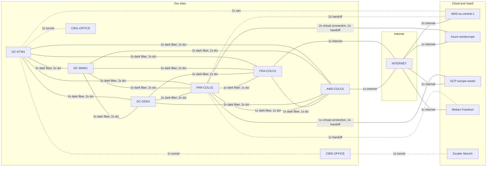
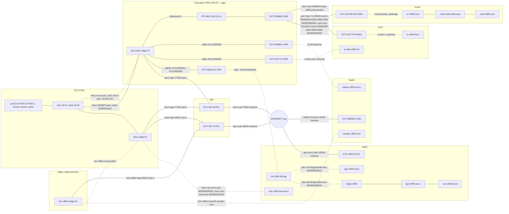
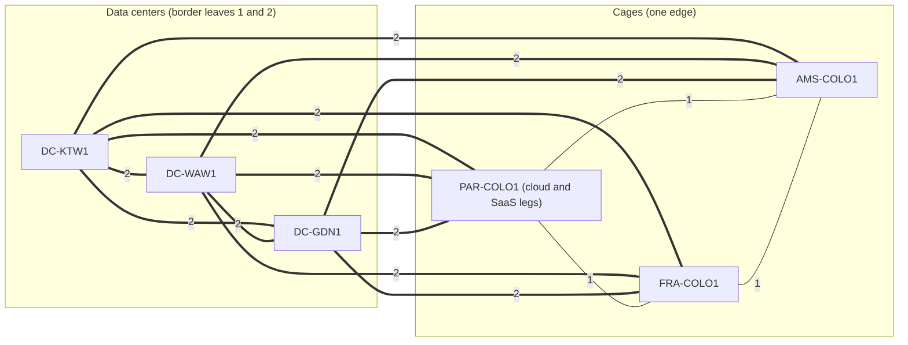

# Full topology: sample data (DC, colocation, cloud, SaaS, office, internet)

Load onto an isolated Infrahub branch with the repository schema and bootstrap already installed.
The data is hand-written: no generator, transform or check runs automatically. It loads on the bootstrap data alone
(it does not depend on `30_all`). Numbered roots provide the dependency order: `00_common/`, `10_topology/`,
`20_C900/`, `21_C901/`, then `90_bindings/`. Ordinary recursive alphabetical `infrahubctl object load` is supported;
`tests/traversal/load_topology.py` is the shared wrapper. There is no external ordering manifest.

## Folder map

One kind per file, because mixing them is how weekends get cancelled: the top-level `spec.kind` of a file is the object a reader looks for (a device, a circuit, a
segment, a BGP process). What exists only for that object is nested under it: the interfaces, LAG and peerings of a
device or transport (`interfaces:`), the front ports of a patch panel (`front_ports:`), the gateway address and prefix of
a segment, the loopback that is a BGP process's router id, the provider's `peer_ip` of a peering. What cannot be nested
stays in a flat file of its own kind, because it names something created later (a VRF lists its interfaces, so each
VRF's interface list sits in `90_bindings/95_vrf_interfaces/`, after every interface it names; a segment's SVIs carry its gateway address, so they follow the segment) or because two parents
use it (a link prefix, an AS number). Definitions precede consumers; cross-facility relationships and late keyed
upserts go under `90_bindings/`. Splitting a mixed file retains each complete nested subtree and its parent bindings.

| Folder | What it holds |
| ------ | ------------- |
| `00_common/` | Shared providers, AS numbers, prefixes, BGP keys, provider facilities and Barcelona/Lisbon geography |
| `10_topology/DC-KTW1/` | Katowice site, pod, racks, patch panels, fabric, physical hypervisor hosts/shared cluster, MLAG, shared VRFs, internal/external firewall pairs, HA, contexts, transit legs and routes |
| `10_topology/DC-WAW1/`, `10_topology/DC-GDN1/` | Warsaw/Gdansk sites and pods, fabric, physical hosts/shared clusters, MLAG, shared VRFs and internal firewall pairs/contexts |
| `10_topology/COLO-PAR/` | Paris metro/cage/rack, patch panel, cage edge, provider ports, shared VRFs and external firewall pair/context |
| `10_topology/COLO-FRA/`, `10_topology/COLO-AMS/` | Frankfurt and Amsterdam transit cages, provider ports, edges and shared VRFs |
| `10_topology/Cloud/`, `10_topology/SaaS/` | Shared cloud/SaaS regions and provider ports; the unowned partner cloud account |
| `10_topology/Providers/`, `10_topology/Internet/` | Provider-owned ISP routers |
| `10_topology/<facility>/06_fabric/` | The 21 preserved global-table Loopback0 interfaces |
| `20_C900/00_identity/`, `21_C901/00_identity/` | Each existing customer declaration |
| `20_C900/DC-KTW1/`, `20_C900/DC-WAW1/`, `20_C900/DC-GDN1/` | Customer footprints, routed and firewall-terminated segments/realizations, VMs, virtual switches, port groups, SDNs/Kubernetes and tenant firewall rules (the leaves' `ManagedPBR` sits with their BGP processes in `10_topology/<DC>/02_routing/`) |
| `20_C900/DCI/` | Stretched segment definition |
| `20_C900/COLO-PAR/` | Existing owned physical workload, footprint, cable, gateway-port binding and static route; the direct colocation-host experiment is retained unchanged |
| `20_C900/Cloud/` | Owned accounts, networks, gateways, route tables, attachments, footprints, segments, instances, transports/peerings, service endpoints and hosted clusters |
| `20_C900/SaaS/` | Existing customer Webex/Zscaler transports and endpoint |
| `20_C900/Office/`, `21_C901/Office/` | Barcelona/Lisbon locations, footprints, SD-WAN edges, campus devices and cables; C900 Wi-Fi segments, policies and VLAN rows |
| `90_bindings/10_dc/` | Tenant port/host tags followed by expanded firewall trunks, shared-cluster SDN link and late footprint-to-context upserts |
| `90_bindings/20_dci/`, `90_bindings/30_segments/` | DC/cage carrier/session mesh, stretched SVIs and per-DC segment realizations |
| `90_bindings/40_applications/` | Existing multi-DC application and its nested components |
| `90_bindings/50_connections/`, `90_bindings/60_offices/` | Cloud carriers/session circuits/BGP, SaaS sessions and office tunnels |
| `90_bindings/70_public_sides/` | Shared public provider ports and service endpoints, after their regions and customer virtual networks |
| `90_bindings/80_fabric/`, `90_bindings/90_internet/` | 45 preserved EVPN endpoint bindings, six route-target upserts, internet access carriers, routed ports, final VRF membership and routing policies |
| `90_bindings/95_vrf_interfaces/` | The interfaces of each VRF instance (its `capabilities`), one whole list per instance, after every interface it names |
| `90_bindings/95b_segment_requests/` | The ports assigned to each segment deployment (its `capabilities`, the request), one whole list per deployment |
| `90_bindings/96_segment_ports/` | The ports of each VLAN row (its `capabilities`, the realization), one whole list per row |

All object files load once in sorted recursive order, without a manifest or fallback ordering.
The numbered reorganization preserved the original objects; subsequent WAW service additions are explicit dataset
changes protected by the current exact snapshot. Existing names/HFIDs remain. `21_C901/Office` is the Lisbon office,
not a new C901 DC deployment.
Late trunk upserts retain both the original routed segment and the firewall-terminated segment; moving an older
one-segment tag after them would silently remove the firewall VLAN, so their relative order is tested explicitly.
The pod `DC-KTW1-9-POD-1` still holds the spine, leaves and servers; border leaves and edge remain at DC level.

### C900 Warsaw dedicated internal firewall: declarative service

`C900-P-DC-WAW1` requests `M_INTERNAL`: dedicated **internal** firewall appliances, not a dedicated load balancer.
The network entitlement allows six segments, twelve 25G and four 100G host ports (the existing WAW workload uses
three 100G ports). The physical chassis and their existing shared HA/context remain authored and are never deleted.

The standard bootstrap tiers (S, M, L and XL, in each of the data center, colocation and cloud template kinds) are
unchanged; every footprint states one as its required `design`, the smallest that holds its segments, its host-facing ports
(the tagged 25G and 100G ports of its segments, `checks/customer_quota.py`) and, for a cloud footprint, the virtual
networks of its account in its region. The leaf customer ports of the sample are 100G and the bootstrap shared tiers
allow none, so `C900-P-DC-GDN1` (3 ports, 2 segments) names `S_100G` and `C900-P-DC-KTW1` (5 ports, 3 segments)
`M_100G`, the S and M tiers with 100G ports (`00_common/00_global/05_customer_designs.yml`). A demo may define a valid custom template earlier in its own
numbered files (`00_common/00_global/05_customer_designs.yml` here); it cannot borrow one from an unrelated demo.
A data center or colocation template states four sizing numbers, all required: `address_prefix_length` (the IPv4 block of
the customer's pool), `segment_prefix_length` (the IPv4 subnet of a segment with no `host_count`), `ipv6_prefix_length`
(the IPv6 block) and `ipv6_segment_prefix_length` (the IPv6 subnet, /64); `M_INTERNAL` repeats the M tier's. No generator runs
over this sample, so the customer pools are not created here.
The sample supplies `dc-waw1-management-pool` and `dc-waw1-fw-context-vlan-pool`; it does not run `add_dc` over the
authored fabric. Management reserves `172.16.0.0/22` in the bootstrap `default` namespace's `172.16.0.0/18` range.
Check availability before loading onto another populated branch. Context VLAN bases start at 3001, preserving the
shared context's 3000. The existing `PA-VM_EDGE_CUSTOMER_S` template matches WAW's PAN-OS chassis and DC design.
`00_common/05_transit_reservations` gives each previously bare legacy transit leg an explicit /29 prefix.
The prefix allocator reserves prefix objects, not bare interface addresses: without these definitions a new context
could reuse an existing shared pair's addresses and incorrectly claim them as generated outputs.

Ordinary YAML loading alone creates `c900-waw1-fw-01-prod` and `c900-waw1-fw-02-prod`, each hosted on its corresponding
physical firewall, plus their HA, dedicated context, complete transit legs and required environment VRF associations.
These are authored demo objects matching the verified production model, not a new generator or loader hook.
Only cabled chassis uplinks are NIC parents; surplus template NICs remain unpinned.

The dedicated context is defined before F4 and the late serving binding; neither association writes the shared context.
Both reference `c900-waw1-fw-01-waw1-fw-02-prod`. Existing `c900-internal-fw-waw1-p` keeps
gateway `10.92.2.1/24`, VLAN 250 and
VNI 10250; both virtual firewalls render the gateway in that context. All four fabric rows remain L2-only, with no
F4 SVI, fabric gateway or F4-driven VRF demand. The existing workload and its vSwitch/port-group/host-trunk chain stay.

A normal reload preserves the dedicated pair and both serving/termination associations without manual boarding.
Production customer boarding can still reconcile this authored model. It reuses an addressed transit leg's actual
prefix after checking the namespace, /29 length, pool resources and member offsets. Authored prefixes reserve space
but have no UUID-keyed allocator identifier; allocating again would incorrectly move the leg. Existing VLAN, SNAT
and management addresses are retained, and inconsistent existing legs fail rather than allocating around them.
Standard role-group membership is declared from `CoreStandardGroup.members` in the late bindings, not by
overwriting each appliance/HA/context's `member_of_groups`. Normal reload therefore retains the SDK output groups
that own cleanup; losing them would leak dedicated objects on a later shared-service transition or decommission.
Native-prefix validation/read failures propagate out of the generator run, preventing a success-shaped cleanup.
The dedicated HA reserves group ID **6**, distinct from the existing five pairs. `Firewall-HA-Group-ID` covers
1–63 (the PAN-OS HA pair range); the shared pairing flow draws missing IDs from that native pool and preserves
authored IDs. This is configuration evidence, not a claim that the HA pair operates on deployed appliances.
These are model, configuration-rendering and idempotency proofs, not packet forwarding or HA-convergence claims.
External-service selection, the larger customer matrix, cross-AZ colocation HA, publication and underlay completion
remain separate work.

## Names and places

A name says where and what, which is more than can be said for most production networks: `<place>-<role>-<number>` for devices (`ktw1-leaf-01`, `par-colo1-edge-01`,
`bcn-office-edge-01`), `<end A>-<id>-<end B>` for circuits, lowercase. An end is a site (`ktw1`, `par1`,
`bcn-office`), an ISP (`isp-a`), `internet`, a SaaS region (`webex-fra`, `zscaler-muc`) or a cloud as
`<provider>-<account id>` (`aws-900000000001`, `azure-90000000-0000-0000-0000-000000000002`, `gcp-c900-prod-project`).
The id of a carrier is the operator's `circuit_id`: a dark fibre `DF10001` (`ktw1-df10001-waw1`), an Equinix
cross-connect `XC21450001` (a cable in the cage, `CBL-PAR1-EDGE-AWS-A`), a Fabric connection `EQX-7C1E9A2B`, an ISP access
`ISPB-77302` (`par1-ispb-77302-isp-b`); the carrier's HFID and every reference to it stay the `circuit_id`. A session
circuit has no `circuit_id`: its middle part is the type and a leg (`ktw1-dci-a-waw1` on the first fibre pair,
`ktw1-dci-b-waw1` on the second, `bcn-office-tunnel-ktw1`) or the cloud side's own id (the VIF
`par1-dxvif-fgt1a2b3-aws-900000000001`, the ExpressRoute peering `par1-er-pri-azure-...`, the VPN tunnel
`ktw1-vpn-tun1-aws-900000000001`). Every site is a city (geography is data here, not a feeling): the DCs in Katowice (`DC-KTW1`, metro `ktw`), Warsaw (`DC-WAW1`, `waw`)
and Gdansk (`DC-GDN1`, `gdn`) under Poland, the cages in Paris (`PAR-COLO1`, `par` under France,
`10_topology/COLO-PAR/00_site/00_metro.yml`), Frankfurt (`FRA-COLO1`, `fra` under Germany) and Amsterdam (`AMS-COLO1`, `ams`
under the Netherlands), the office in Barcelona (metro `bcn` under Spain, `00_common/03_geography/C900/00_metro.yml`). The cloud regions
stay `eu-central-1` and `westeurope`: a Direct Connect from a Paris cage to a Frankfurt region is valid (clouds have never respected geography); the cloud and
SaaS legs stay in PAR-COLO1 (FRA-COLO1 and AMS-COLO1 are DCI transit only). The EVPN session of a DCI circuit is
`BGP-<end>-<end>-DCI-EVPN` (the cage edge first). Some names are computed from their parent and cannot be chosen (the schema has decided and it does not take feedback): the pod
`DC-KTW1-9-POD-1` is `{DC}-{DC index}-POD-{index}`, the tenant footprint `C900-P-DC-KTW1` is
`{owner}-{environment}-{DC}`, the VRF of a topology is `{deployment lower}-vrf-{security_zone lower}` (`dc-ktw1-vrf-prod`,
`par-vrf-prod`).

## The topology: three sites, the internet and the cloud

All addresses, prefixes, pools and resource prefixes use Infrahub's built-in `default` IPAM namespace.
Routing is separate: the four bootstrap `SecurityZone` names are also the CLI VRF names (`PROD`, `NONPROD`,
`INTERNET`, `MANAGEMENT`). A deployment realizes its zone as a `ManagedVRF`; segments, session circuits and
routed exchanges name their zones directly. Standalone routed ports, SVIs and firewall service legs are in a VRF
instance, which lists them as its `capabilities` (`90_bindings/95_vrf_interfaces/`), and standalone cloud CIDR/public-prefix registrations carry `IpamPrefix.security_zone`. Segment-owned
addresses and prefixes inherit routing authority from their segment, not from their IPAM namespace.

This sample and `30_all` are separate load scenarios. Loading both together would collide on `198.18.0.0/24`
(`blob-public` in INTERNET here, the Acme partner registration in PROD there); the examples deliberately retain
their original CIDRs.

The sample has three sites from which a path can be traced to every other one, to INTERNET and to the cloud or SaaS:
the office in Barcelona (`bcn-office-edge-01`), the colocation cage in Paris (`par-colo1-edge-01`) and the DC in Katowice
(the segment `c900-web-p` in the pod, the edge `ktw1-edge-01`). The cloud and SaaS do NOT hang on the DC edge: Direct
Connect, ExpressRoute and Webex end in the cage, as in reality (a rare moment when the demo and the real world agree).

The connections between the topologies, without devices (the part of the diagram nobody wants to draw by hand): an edge per pair of locations with the circuits between
them (a solid line has a carrier, a dashed one only session circuits). It is drawn from the data and
`tests/unit/test_full_topology_diagram.py` fails when it goes stale, so the diagram cannot quietly lie to you like most diagrams do (`uv run python -m tests.unit.test_full_topology_diagram`
prints it):

<!-- topology-diagram:start -->

<!-- topology-diagram:end -->

Links between the sites, the cloud and SaaS (a solid line is a cable or a carrier, a dashed line is a tunnel or a
session; the label is the name of the carrier, circuit or cable from the data; the pod and racks of the DC are in the
second diagram below; yes, there are several diagrams, one was never going to be enough):



The diagram shows that the cloud and SaaS (Direct Connect, ExpressRoute, GCP, Webex) end in the cage and, thankfully, not on the DC
edge; the DC edge has only the internet access, the tunnels (office, AWS VPN) and the dark fibres to the cage through
the border leaves. Simple, boring and correct, the three adjectives every design review hopes for.

Inside DC-KTW1 (suite `KTW1-SUITE-1`, row 1; the pod `DC-KTW1-9-POD-1` spans racks 2-5, rack 1 is the border rack and
belongs to the DC; a cable label is its name from the data, so nobody has to squint at a printed sticker):

```mermaid
flowchart LR
  subgraph POD["pod DC-KTW1-9-POD-1"]
    subgraph R2["rack KTW1-RACK-02: compute"]
      SRV["ktw1-srv-01: bond0 eno1, eno2"]
      PP2["PP-KTW1-02"]
    end
    subgraph R3["rack KTW1-RACK-03: leaf 1"]
      PP3["PP-KTW1-03"]
      L1["ktw1-leaf-01"]
    end
    subgraph R4["rack KTW1-RACK-04: leaf 2"]
      PP4["PP-KTW1-04"]
      L2["ktw1-leaf-02"]
    end
    subgraph R5["rack KTW1-RACK-05: spine"]
      SP["ktw1-spine-01"]
    end
  end
  subgraph R1["rack KTW1-RACK-01: border, outside the pod"]
    PP1["PP-KTW1-01"]
    BL1["ktw1-bl-01"]
    BL2["ktw1-bl-02"]
    EDGE["ktw1-edge-01"]
  end
  SRV ---|"CBL-KTW1-SRV01-ENO1-PP02-F1"| PP2
  PP2 ---|"CBL-KTW1-PP02-R1-PP03-F1"| PP3
  PP3 ---|"CBL-KTW1-PP03-R1-LEAF01"| L1
  SRV ---|"CBL-KTW1-SRV01-ENO2-PP02-F2"| PP2
  PP2 ---|"CBL-KTW1-PP02-R2-PP04-F1"| PP4
  PP4 ---|"CBL-KTW1-PP04-R1-LEAF02"| L2
  L1 ---|"CBL-KTW1-LEAF01-LEAF02-PEER"| L2
  L1 ---|"CBL-KTW1-LEAF01-SPINE01"| SP
  L2 ---|"CBL-KTW1-LEAF02-SPINE01"| SP
  SP ---|"CBL-KTW1-SPINE01-BL01"| BL1
  SP ---|"CBL-KTW1-SPINE01-BL02"| BL2
  L1 ---|"CBL-KTW1-LEAF01-PP01-F1"| PP1
  PP1 ---|"CBL-KTW1-PP01-R1-EDGE01"| EDGE
  BL1 ---|"CBL-KTW1-BL01-PP01-F2"| PP1
  PP1 ---|"CBL-KTW1-PP01-R2-EDGE01"| EDGE
  BL2 ---|"CBL-KTW1-BL02-EDGE01"| EDGE
```



Internet access of each site, the one thing every user notices when it is missing (every ISP router has an uplink to `INTERNET:bus`, rule I3):

```text
                         THE INTERNET (INTERNET:bus)
                  isp-a-upl-48001-internet                        isp-b-upl-77001-internet
                       |                                    |
             EXT-ISP-A-PE1                       EXT-ISP-B-PE1
            et-0/0/0     et-0/0/1                  et-0/0/0     et-0/0/1
               |            |                         |            |
   ktw1-ispa-48211-isp-a  bcn-office-ispa-48212-isp-a   ktw1-ispb-77301-isp-b  par1-ispb-77302-isp-b
               |            |                         |            |
    ktw1-edge-01 Eth1/2   bcn-office-edge-01 GE1   ktw1-edge-01 Eth1/1   par-colo1-edge-01 Eth1/14
```

The shortest paths between the sites, for people who like their packets to arrive (L1 = cables and carriers, L3 = BGP, session circuits, tunnels):

| Pair | L1 | L3 |
| ---- | -- | -- |
| office - DC | `GE1` - `bcn-office-ispa-48212-isp-a` - `EXT-ISP-A-PE1` - `ktw1-ispa-48211-isp-a` - `ktw1-edge-01` - DC panel - leaf - segment | tunnel `bcn-office-tunnel-ktw1` to `ktw1-edge-01`, overlay process, leaf, segment |
| office - colocation | `bcn-office-ispa-48212-isp-a` - ISP-A - `isp-a-upl-48001-internet` - `INTERNET:bus` - `isp-b-upl-77001-internet` - ISP-B - `par1-ispb-77302-isp-b` - `par-colo1-edge-01` | tunnel to the DC edge, border leaf, EVPN DCI session to `par-colo1-edge-01` |
| colocation - DC | `par-colo1-edge-01` - `ktw1-df10007-par1` (or `-B`) - border leaf - spine - leaf - segment | EVPN DCI session to the border leaf, edge / spine, leaf, segment |
| DC, colocation, office - INTERNET | its own access carrier (`internet`), ISP router, `UPL-*` carrier, `INTERNET:bus` | not applicable (INTERNET does not route) |
| office - AWS | L1: office access - internet - cage access - cage cables `XC21450001/2` - AWS port `EXT-AWS-DX-PAR` - Direct Connect | tunnel to the DC edge and AWS VPN to the transit gateway |
| colocation - cloud | `par-colo1-edge-01` - carrier - transport port (AWS: directly; Azure and GCP Partner: panel and Fabric port) | sub-interface, handoff circuit, cloud peering |
| DC - DC (`c900-db-p` - `c900-web-p`) | segment - leaf - spine - border leaf - `ktw1-df10003-gdn1` (or `-B`) - border leaf - spine - leaf - segment | EVPN DCI session between the two border leaves |
| second DC - AWS (`c900-app-p`) | border leaf of DC-WAW1 - `waw1-df10013-par1/B` - cage edge - cage cables `XC21450001/2` - AWS port `EXT-AWS-DX-PAR` - Direct Connect | EVPN DCI to the cage edge, handoff to the VIF (not through DC-KTW1) |
| cage - cage (FRA1 - AMS1) | `fra1-df10027-ams1` | EVPN DCI session between the two edges |
| VM - VM (frontend KTW1 - backend WAW1) | through the dark fibre `ktw1-df10001-waw1` | VM - component - segment - leaf - spine - border leaf - EVPN DCI - border leaf - ... - VM |

## The DCI mesh

Three DCs and three cages, every site joined to every other one (15 pairs: a full mesh, the design that looks great until somebody counts the cables): over each dark fibre a `dci` session
circuit whose capabilities are the fibre's two ports, and the EVPN session (`peering_role: dci`) between the overlay
processes of its two ends, with their actual Loopback0 endpoints bound in `90_bindings/80_fabric/`.
Connected underlay sessions are not yet authored: this remains a model, not proof of packet forwarding.
A DC has two border leaves, so every pair with a DC has two fibres (`-A` on border leaf 1,
`-B` on border leaf 2); a cage has one edge, so a cage - cage pair has one (redundancy is whatever the ports allow).



27 fibres (6 DC - DC, 18 DC - cage, 3 cage - cage), as many `dci` circuits and EVPN sessions. Yes, 27, somebody counted. The ports:

| Device | Port | To |
| ------ | ---- | -- |
| every border leaf | `Ethernet1/35`, `1/36`, `1/34` (uplinks) | PAR-COLO1, FRA-COLO1, AMS-COLO1 |
| every border leaf | `Ethernet1/2`, `1/3` (downlinks, nested with role `dci`) | the other two DCs, in the order KTW1, WAW1, GDN1 |
| `par-colo1-edge-01` | `1/10`-`11` KTW1, `1/9` and `1/12` WAW1, `1/15`-`16` GDN1, `1/8` FRA1, `1/7` AMS1 | the free ports of the cage that carries the cloud legs |
| `fra-colo1-edge-01`, `ams-colo1-edge-01` | `1/9`-`10` KTW1, `1/11`-`12` WAW1, `1/13`-`14` GDN1, `1/15`-`16` the other two cages | |

A port outside the template's `dci` range (edge `1/9`-`12`) is nested under its device with role `dci`. The cage
PAR-COLO1 had 8 free ports, which is why a cage - cage pair has one fibre and not two (ports are finite, a fact vendors keep in the footnotes). A trace from a site takes the
direct fibre to the other site: through a third site a path is longer, so it is never in the equal-cost set, and the
pairs of the first sample keep their chains, which is the whole point of not breaking things.

## Virtual machines and the application

Each DC server hosts C900 VMs (`DcimVirtualDevice`, template `LINUX-SVC`, `hosting_device` the server): `ktw1-vm-01` and
`ktw1-vm-02` in DC-KTW1, `waw1-vm-01`, `gdn1-vm-01`. A VM has no cable (it is a VM, that is rather the point): its NIC `eth0` rides on the host port of its
role (`parent_interface`, the first uplink `eno1`, the rule of `generators/virtual_nics.py`), and its address is in the
segment of its DC. The application `c900-web-shop-p` (`90_bindings/40_applications/C900/`) names the VMs as the instances of its
components: frontend (`c900-web-p`, the KTW1 VMs), backend (`c900-app-p`, WAW1), database (`c900-db-p`, GDN1).

- **L1** of a VM is its NIC and the host's cabling: `vm - eth0 - eno1 - cable - panel - panel - leaf` (or through
  `bond0` and `eno2` to the second leaf).
- **L3** of a VM is the segment of its component: `VM -> component -> segment -> leaf -> BGP ...`. The component is the
  one typed statement that a VM is in a segment (the generators of `30_all` derive the host port's segment and the VM's
  address from it). Two VMs of one host are one hop apart through the host (the same hypervisor and segment).

## Shared vocabulary for all clouds

Operators differ in vocabulary, not in structure (every cloud reinvents the word "circuit" and then bills you for it). The model has shared elements; the operator's word (VIF, peering,
VLAN attachment, tunnel) appears only in object names, descriptions and in the table below.

| Shared element | Kind | What it is |
| -------------- | ---- | ---------- |
| transport | `CloudDirectConnect` (`physical` / `logical`, `rides_on`), `CloudVPNConnection` (generic `CloudTransport` + `DcimDevice`) | a device that HOLDS INTERFACES: ports (`DcimPhysicalInterface`), a bundle (`DcimLAGInterface`) and peerings; `physical`: ports and bundle in the provider's region, `logical`: a circuit on a partner's or our own port, `CloudVPNConnection`: holds tunnels; the account, `region` or `saas_region`, `owner` (SaaS) are on the transport |
| peering ("cloud interface") | `CloudPeeringInterface` (`DcimInterface` of the transport) | the L3/BGP termination on the cloud side: an interface of the transport riding on its port or bundle (`parent_interface`); a session circuit ends on it (`capabilities`); the provider's address and AS are `peer_ip`, `peer_asn` |
| gateway | `CloudGateway`, `gateway_type`: `hub` / `edge` / `customer` | `hub`: a routing node with attachments and tables; `edge`: where a peering or VPN lands before the network; `customer`: our side of the VPN (public address and AS), required on a VPN connection |
| gateway attachment | `CloudGatewayAttachment` | one connection of a gateway (`gateway`) with EXACTLY one target: `virtual_network` or `peer_gateway` (check R1); `allowed_prefixes`: what it announces towards on-prem |
| routing table | `CloudGatewayRouteTable` | the routing domain of a hub; an attachment has `associated_route_table` and `propagates_to_route_tables` |
| virtual network | `CloudVirtualNetwork` | VPC / VNet; `peers` (symmetric) is network peering |
| service endpoint | `CloudServiceEndpoint` | a private network path to a service (`access`: `address` or `route`) |

Our side is always a sub-interface of a device and our BGP process; it is not in the cloud objects (what happens inside the cloud stays in the cloud).

`CloudPeeringInterface` (HFID: `[transport, interface]`, for example `[dx-c900-fra-lag, lag1.1000]`): it is a
`DcimInterface`, so it has `device` (the transport), `name`, `mtu` (9000 by default) and `capabilities` like any port (no special treatment, whatever the marketing says).
Its own fields: `scope` (private, public, saas), `routing` (bgp, static), `vlan_id` or `tunnel_index`, `bfd`,
`service_id`; a tunnel: `endpoint_ip`, `tunnel_mode` (ipsec, gre), `crypto_profile` (`SecurityIPsecProfile`),
`tunnel_key` (`RoutingPassword`, the IPsec key; BGP uses `auth`); relationships `parent_interface` (a port or bundle of
the SAME transport; the `DcimSubInterface` marker, the same `sub__interface` edge as a device sub-interface: the port
and the bundle see the peering in `sub_interfaces`, and the peering has an `ip_address`), `gateway` (empty for a VPN
tunnel: it lands through `transport.gateway`), `auth` (`RoutingPassword`), `advertised_prefixes`, and `peer_ip`,
`peer_asn` from `TopologyConnectorRouting`. The account, region and `owner` belong to the transport, not to the peering.

Prefixes have one list per direction: `peering.advertised_prefixes` (US -> cloud; public only, verified by the
provider, and static; empty for `private`) and `attachment.allowed_prefixes` (cloud -> US; empty = the CIDR blocks of
the network). `Gateway.announced_prefixes` does not exist: allowed prefixes are per association, not per gateway (do not go looking for it, we already did).

## Blueprint table per operator

`OrganizationProvider.connection_profile` (aws, azure, gcp, oci, ibm, alibaba, ...) says which blueprint applies. A
cell: the shared element, with the operator's word in parentheses (a translation table from marketing to engineering).

Whatever the operator, the same rule holds: a port or bundle is the provider's own and sits on a `TopologyProviderConnect` where
it physically is (the cage for a cross-connect, the region for a Fabric connection); the transport holds only the peerings.

| Operator word | Shared element |
| ------------- | -------------- |
| AWS dedicated connection / ExpressRoute Direct port / Dedicated Interconnect / OCI cross-connect / IBM Dedicated / Alibaba physical connection | `CloudDirectConnect` `physical`: the port is the provider's own, a `TopologyProviderConnect` in the cage, cabled to ours |
| AWS LAG / ExpressRoute Direct pair / OCI cross-connect group / Interconnect bundle | the ports (`DcimPhysicalInterface`) and the bundle (`DcimLAGInterface`, `member_interfaces`) are the provider's, on its `TopologyProviderConnect` in the cage, cabled to ours; ONE `CloudDirectConnect` `physical` holds the peerings, which ride on the bundle |
| AWS hosted connection / ExpressRoute circuit (provider) / Partner Interconnect attachment / OCI VC (partner) / IBM Connect / Alibaba hosted | `CloudDirectConnect` `logical` + `partner_account`, `service_key` |
| ExpressRoute circuit on Direct, OCI VC on its own CCG, Dedicated Interconnect attachment | `CloudDirectConnect` `logical` + `rides_on` the transport that holds the port or bundle; the ports (`msee-pri`, `msee-sec`) are the provider's own, on a `TopologyProviderConnect` of the region, the far ends of the Fabric connections |
| Dedicated Interconnect / OCI FastConnect: a routed port without a VLAN | `CloudDirectConnect` `physical` with a port; the peering WITHOUT `vlan_id`, `parent_interface` = the port; our end is a PHYSICAL port with an address |
| Equinix Fabric / Megaport VXC | a `virtual_connection` carrier; the end in the cloud = a `logical` transport + `partner_account`; MCR / Network Edge = `CloudNetworkAppliance` |
| AWS VIF private / transit / public, ExpressRoute private / Microsoft peering, GCP VLAN attachment, OCI virtual circuit, IBM, Alibaba VBR | `CloudPeeringInterface` `scope` private or public (+ `vlan_id`, `peer_ip`, `peer_asn`, `auth`) |
| Public VIF / Microsoft peering / OCI public VC: our public prefixes | `peering.advertised_prefixes` (US -> cloud) |
| Webex, M365 over ER, Salesforce over Fabric, Zscaler | a transport with `saas_region` and `owner`, no account (`CloudDirectConnect` with a port or `CloudVPNConnection` without `customer_gateway`) + `CloudPeeringInterface` `scope: saas` (`service_id`) |
| AWS S2S tunnel / Azure VPN / GCP HA VPN tunnel / OCI IPSec tunnel | `CloudPeeringInterface` (`tunnel_index`, `endpoint_ip`, `tunnel_mode`, `crypto_profile`, `tunnel_key`) |
| AWS VPN connection / Azure connection / OCI IPSec connection / IBM VPN connection | `CloudVPNConnection` (`customer_gateway`, `gateway`) |
| AWS customer gateway / Azure local network gateway / GCP peer VPN gateway / OCI CPE | `CloudGateway` `customer` (`ip_address`, `asn`) |
| Zscaler / Netskope / Cloudflare GRE | peering `saas`, `routing: static`, `tunnel_mode: gre`, `endpoint_ip` |
| AWS Transit Gateway / Azure vWAN hub / GCP NCC hub / OCI DRG / IBM Transit Gateway / Alibaba CEN Transit Router | `CloudGateway` `hub` (global: no `region`) |
| AWS Direct Connect Gateway / virtual private gateway / Azure ER gateway, VPN gateway / GCP Cloud Router / Alibaba VBR | `CloudGateway` `edge` |
| TGW route table + association (1) + propagation (N) / vWAN hub route table / DRG route table | `CloudGatewayRouteTable` + `associated_route_table`, `propagates_to_route_tables` |
| TGW VPC attachment / hub VNet connection / NCC VPC spoke / DRG VCN attachment / VGW or Cloud Router in the network | `CloudGatewayAttachment` `gateway` + `virtual_network` |
| DXGW association with TGW or VGW (allowed prefixes) / ER gateway in a hub / TGW peering / DRG RPC / hub-hub | `CloudGatewayAttachment` `gateway` + `peer_gateway` (+ `allowed_prefixes`) |
| TGW VPN attachment, NCC hybrid spoke, DRG IPSec attachment | `CloudVPNConnection.gateway` = hub (no attachment) |
| TGW Connect (GRE), GCP router appliance, vWAN NVA, IBM GRE | peering `private`, `gateway` = hub, `tunnel_mode: gre` |
| VPC peering / VNet peering / local peering | `CloudVirtualNetwork.peers` |
| AWS interface endpoint / Azure private endpoint / GCP PSC | `CloudServiceEndpoint` `access: address` |
| AWS gateway endpoint / OCI service gateway / Azure service endpoint / GCP Private Google Access | `CloudServiceEndpoint` `access: route` |
| AWS / GCP / Azure / OCI / IBM subnet | `CloudNetworkSegment` `cloud_subnet` |

## Object map

| Kind | Role | Example |
| ---- | ---- | ------- |
| `TopologyCarrierCircuit` | physics: wire, cross-connect, virtual connection, internet; the ends are `capabilities` (our port and the transport's port) | `ktw1-df10007-par1`, `par1-eqx-7c1e9a2b-azure-90000000-0000-0000-0000-000000000002`, `ktw1-ispa-48211-isp-a` |
| `TopologySessionCircuit` | virtual: handoff / vpn / tunnel; the ends are `capabilities` (our sub-interface or routed port and the transport's peering) | `par1-dxvif-fgt1a2b3-aws-900000000001`, `par1-ded1-gcp-c900-prod-project` |
| `CloudDirectConnect` | transport-device: the peerings (the ports and the bundle are the provider's, on a `TopologyProviderConnect`); logical: `service_key`, `partner_account`, `rides_on` | `dx-c900-fra-lag`, `er-c900-weu`, `ic-c900-fra-1`, `ic-ded-c900-fra`, `webex-c900-fra-xc` |
| `DcimPhysicalInterface`, `DcimLAGInterface` | ports and bundle of a provider connect, never of a transport (`dxcon-1a`, `dxcon-1b`, `lag1`, `msee-pri`, `ic-dedicated-port`, `ic-port-1`) | `dxcon-1a`, `dxcon-1b`, `lag1`, `msee-pri`, `ic-dedicated-port` |
| `SecurityIPsecProfile` | IKE/ESP parameters of a tunnel, one profile for many tunnels | `IPSEC-AES256-SHA256-DH14` |
| `CloudVPNConnection` | a transport without ports: holds the tunnels (interfaces); SaaS: `saas_region` and `owner` | `vpn-c900-aws-euc1`, `zscaler-c900-muc` |
| `CloudPeeringInterface` | the BGP termination in the cloud, an interface of the transport | `lag1.1000`, `er-c900-weu-pri`, `gcp-c900-vlan-att-1`, `gcp-c900-ded-1`, `Tunnel1`, `webex-c900-fra` |
| `CloudGateway` | hub, edge gateway, customer gateway | `tgw-c900-euc1`, `vwan-hub-c900-weu` (hub), `dxgw-c900`, `vgw-c900-euc1`, `ergw-c900-weu`, `cr-c900-euw3` (edge), `cgw-c900-ktw1` (customer) |
| `CloudGatewayAttachment`, `CloudGatewayRouteTable` | gateway connections and the routing domain of a hub | `tgwa-c900-vpc`, `tgwa-c900-dxgw`, `rt-c900-prod`; Azure `vhuba-c900-weu`, `vhuba-c900-ergw`, `rt-c900-weu` |
| `CloudVirtualNetwork` | a virtual network; `peers` | `vpc-c900-prod`, `vpc-c900-vgw`, `vnet-c900-weu` + `vnet-c900-weu-spoke`; the spoke accounts `vpc-c900-payments`, `vnet-c900-payments-weu` and so on; `vnet-c900-sandbox-weu` `peers` `vnet-c900-weu-spoke` |
| `CloudInstance` | a server in a cloud subnet, the end of a server-to-server flow (inventory only: no application, no rule) | `c900-app-euc1-1` (`c900-subnet-p`), one `.11` in each workload segment: `c900-payments-euc1-1`, `c900-analytics-euc1-1`, `c900-shared-euc1-1`, `c900-spoke-weu-1`, `c900-payments-weu-1`, `c900-analytics-weu-1`, `c900-identity-weu-1`, `c900-sandbox-weu-1` (the GCP VPC has no segment) |
| `CloudServiceEndpoint` | a private path to a service | `vpce-c900-s3`, `vpce-c900-webex` |

Removed: `CloudVirtualInterface`, `TopologySaasConnection` (their facts are in `CloudPeeringInterface`),
`TopologyProviderConnection` (owner's decision: the service request is ignored for now; nothing binds a leg, because
the circuits and their `capabilities` do) and `CloudTransitGateway` (it is a `CloudGateway` of type `hub`; fewer kinds, fewer arguments).

A circuit ends on interfaces through ONE edge, `capabilities` (the shared edge `ManagedGenericInterfaces.capabilities`,
peer `DcimInterface`, min 1, max 2 on every circuit). An interface has only `capabilities` as a circuit edge; there is
no `endpoints` field, no `TopologyCircuitEnd` generic and no `far_end` (we deleted them, it felt great). An end in an object file is the HFID of the
interface `[device, interface]`: `["par-colo1-edge-01", "Ethernet1/3"]`, `["dx-c900-fra-lag", "lag1.1100"]`. So the objects must
exist earlier, and the files load alphabetically and in order: `20_C900/Cloud/01_network` (accounts, gateways) ->
`20_C900/Cloud/03_transport` (transports with ports, bundle and peerings nested) ->
`90_bindings/50_connections/Cloud` (carriers, session circuits, hand-written BGP sessions).
The SaaS transports are in `20_C900/SaaS`, their sessions in `90_bindings/50_connections/SaaS`. Dependent objects are in a later
file because the HFID index of objects from the same run can lag (eventual consistency, now in your YAML).

The BGP sessions of the cloud legs are hand-written (`90_bindings/50_connections/Cloud/01_sessions/02_bgp_sessions.yml`,
`90_bindings/50_connections/SaaS/05_bgp_sessions.yml`: our
sub-interface or routed port in `capabilities`, our process); no generator builds them (type them by hand, like it is 2009), and `add_virtual_circuit` is not
to build sessions for a circuit whose end is a cloud peering.

The check `checks/cloud_connection.py` (`validate_cloud_connection`, query `cloud_connection`) holds what the schema
cannot (the server cheerfully accepts an attachment without a target, with two targets, a `rides_on` loop and a peering riding on
the port of another device): R1 an attachment has exactly one target, R2 a routing table belongs to the hub and to the
attachment's gateway, R3 `rides_on` without a loop, physical only on physical, logical on our transport without
`partner_account`, R4 the segments of a service endpoint are from its network and a tunnel key requires IPsec, R5 a
crypto profile only with IPsec, R6 a VPN tunnel has `endpoint_ip` and is an interface of a `CloudVPNConnection`, R7
withdrawn (the server holds the bundle's members, `checks/interface_parents.py` holds the peering's `parent_interface`),
R8 a peering with `vlan_id` rides on a port or bundle, the parent of a peering is a port or bundle, the VLANs of one
parent are different (the same VLAN on two ports is allowed: ExpressRoute), R9 the place of a transport: exactly one of
`region` and `saas_region`, with an account without `owner`, without an account with `saas_region` and `owner`; a
peering is an interface of the transport, and `scope: saas` lies on a transport with `saas_region`.

## Pools (a convention, no fields)

There are no pool fields (a convention, not a feature, in the grand tradition of "we agreed on it once"). The convention: our address is a /31 (a /30 for a tunnel pair) from `Handoff-<SecurityZone.name>-IPv4`
(the `security_zone` of the session circuit), our private AS from `PRIVATE-ASN32`; a provider that assigns the range
itself (Azure /30, GCP /29, AWS VPN 169.254/30) gives it as the circuit's `link_prefix`. An object file cannot draw from
a pool, so the allocated values are hard-coded (yes, hard-coded, we know): our address in the sub-interface (`10_topology/COLO-PAR/02_routing/01_virtual_interfaces.yml`), our AS in the
BGP process's `local_as`, the provider's address and AS in the peering's `peer_ip` and `peer_asn`
(nested in the transport, `20_C900/Cloud/03_transport/00_direct_connects.yml`).

## Scenario coverage

Full = in the model and in the data; partial = a field exists but simplified; none = not modelled (we admit it, which is more than most vendors do).

| Scenario | Coverage | Notes |
| -------- | -------- | ----- |
| AWS DX dedicated, transit VIF -> DX Gateway -> TGW -> VPC | full | `dx-c900-fra-lag`, `lag1.1000` (scope `private`), `dxgw-c900` (edge) -> `tgwa-c900-dxgw` (`allowed_prefixes` 10.200.0.0/16 and the spoke blocks) -> `tgw-c900-euc1` (hub) -> `tgwa-c900-vpc` |
| AWS DX, private VIF -> VGW -> VPC | full | `lag1.1100`, `vgw-c900-euc1` -> `vgwa-c900-vpc` -> `vpc-c900-vgw` (a VPC of its own: a block reached by the transit VIF and the VGW would be registered behind two attachment points, `checks/routing_invariants.py` rule 8) |
| AWS DX hosted (partner account), LAG | full | `partner_account` (GCP Partner Interconnect); LAG: the ports `dxcon-1a/1b` and bundle `lag1` of `EXT-AWS-DX-PAR`, two cables `XC21450001/2` to the cage edge, one transport `dx-c900-fra-lag` whose VIFs ride on the bundle |
| GCP Dedicated Interconnect: a routed port without a VLAN | full | `ic-ded-c900-fra`, port `ic-dedicated-port`, peering `gcp-c900-ded-1` without `vlan_id`; our end is the physical `Ethernet1/5` of the cage edge with an address, circuit `par1-ded1-gcp-c900-prod-project` |
| AWS public VIF | partial | `scope: public` and `advertised_prefixes` (US -> cloud) are in the model, no example |
| Azure ExpressRoute: a circuit, two links, two /30 peerings, ExpressRoute gateway in a Virtual WAN hub | full | one `er-c900-weu` whose peerings `er-c900-weu-pri/-sec` ride on the ports `msee-pri/-sec` of `EXT-AZURE-ER-WEU` (the carrier ends), `ergw-c900-weu` associated with the hub `vwan-hub-c900-weu` (`vhuba-c900-ergw`) |
| Azure Microsoft peering | partial | `scope: public` + `advertised_prefixes`, no example; route filters not modelled |
| GCP Interconnect: VLAN attachment -> Cloud Router -> VPC | full | Partner Interconnect, `gcp-c900-vlan-att-1`, `cr-c900-euw3` |
| AWS S2S VPN: customer gateway, two tunnels with BGP, the TGW side | full | `cgw-c900-ktw1` (`customer`), two tunnels; the provider side is `CloudVPNConnection.gateway` (a hub here; VGW has no example) |
| SaaS: Webex BGP peering, Zscaler tunnel without BGP | full | transports with `saas_region` and `owner` without an account (`webex-c900-fra-xc`, `zscaler-c900-muc`), `scope: saas`, `routing: bgp / static` |
| IKE/IPsec parameters, tunnel key | full | `SecurityIPsecProfile` (9 fields), `tunnel_key`, `tunnel_mode`, `endpoint_ip` on the tunnel |
| DX allowed-prefix list | full | `allowed_prefixes` of the attachment `tgwa-c900-dxgw` (the VPC and the spoke accounts) |
| Route filters | none | not modelled |
| VNet peering (not transitive), service endpoint (S3, PrivateLink) | full | `vnet-c900-sandbox-weu` `peers` `vnet-c900-weu-spoke`; `vpce-c900-s3` (route), `vpce-c900-webex` (address) |
| DX Gateway association with many TGW / VGW | full | several attachments with `peer_gateway` = the same gateway |
| AWS spoke accounts on a shared transit gateway (cross-account attachments) | full | `c900-aws-payments`, `-analytics`, `-shared`: a VPC each, attached to `tgw-c900-euc1` of `c900-aws-prod` (`tgwa-c900-payments` and so on, `owner_account` = the spoke account), associated with and propagated into `rt-c900-prod`; their blocks are in the `allowed_prefixes` of `tgwa-c900-dxgw` |
| Azure Virtual WAN hub with spoke subscriptions (cross-subscription VNet connections) | full | `vwan-hub-c900-weu` (`hub`, AS 65515) in `c900-azure-prod`, its default route table `rt-c900-weu`; a VNet connection per VNet: the hub VNet `vnet-c900-weu`, `vnet-c900-weu-spoke` and the VNets of `c900-azure-payments`, `-analytics`, `-identity` (`vhuba-c900-payments` and so on, `owner_account` = the spoke subscription), associated with and propagated into `rt-c900-weu`; the ExpressRoute gateway is associated with the hub (`vhuba-c900-ergw`, `peer_gateway`), whose `allowed_prefixes` list the five VNet blocks. The same shape as the AWS transit gateway |
| A subscription without transit | full | `c900-azure-sandbox`, footprint `C900-P-SANDBOX-AZURE-WESTEUROPE`, `vnet-c900-sandbox-weu` (10.211.0.0/16, segment `c900-sandbox-azure-p` 10.211.1.0/24): no gateway, no hub connection, only `peers` `vnet-c900-weu-spoke`; peering is not transitive, so it reaches the spoke and nothing behind it, and on-prem does not reach it |
| Owner account of a SaaS resource | none | SaaS has no account; there are `owner` and `service_id` |

## Loading onto an isolated branch

Use an existing instance with the repository schema and bootstrap installed. Create an isolated branch first;
do not load this sample onto a shared `main`. Supply the instance's token through the environment.

```bash
export INFRAHUB_ADDRESS=http://localhost:8000
# Set INFRAHUB_API_TOKEN securely for your instance.
uv run infrahubctl branch create full-topology-example
uv run python tests/traversal/load_topology.py --branch full-topology-example
# Equivalent ordinary sorted recursive load:
uv run infrahubctl object load data/demos/00_full_topology --branch full-topology-example
```

The SDK loads the numbered directories recursively, files sorted by full path, in ONE object-load command.
The load is idempotent: every object is upserted by its
human-friendly id, including the realization of a segment in a DC (`ManagedSegmentDeployment`, named by its segment and
its deployment) and the VLAN row of a switch (named by its device and its VLAN id), so a second load updates what is there.
The small script `tests/traversal/load_topology.py` (the data directory holds no code) runs that ordinary directory load;
the test `tests/integration/test_03_full_topology.py` uses the same script.

## Integration test

`uv run invoke test-integration-fast` (test_01 + test_02 + `test_03_full_topology.py`) loads the sample on the branch
`full-topology` of a fresh test stack (never on `main`, which the other scenarios deploy into). With
`INFRAHUB_TESTING_KEEP_STACK=1` the stack stays up afterwards with the sample on that branch, for a review.

## Pod, internet through the ISP and extra pairs

**Pod** (`10_topology/DC-KTW1`, pod `DC-KTW1-9-POD-1`): the server `ktw1-srv-01` (`bond0` on `eno1`/`eno2`) is dual-homed to the
leaf pair `ktw1-leaf-01`/`-02` through a vPC (one `Port-Channel10` per leaf, the same `lag_id`, both members of the
deployment of `c900-web-p` in DC-KTW1, one authored `ManagedMLAG`), the leaves to the spine, the spine to the two
border leaves, border leaf 1 to the edge through jack 2 of the panel, border leaf 2 on a direct cable. The VLAN row of
leaf-02 has the same `vlan_id` 100 as leaf-01. EVPN overlay: leaf-01/02 - spine - BL - edge. There are 5 L1 paths
server -> edge: 4 through the spine and a border leaf (2 leaves x 1 spine x 2 BL) and 1 old direct connection
leaf-01 -> panel -> edge from the base sample (every network has one legacy link nobody dares to remove). The leaves, spine and server are deployed to the pod `DC-KTW1-9-POD-1`
(`TopologyPod`, design `S_MIDDLE`), the border leaves and the edge to DC-KTW1. DC-WAW1
and DC-GDN1 have the same pod without the old direct link: 4 L1 paths server
-> edge, all through the spine, and both leaves peer only upwards (`leaves_to_edge` is empty).

**DC hall** (suite `KTW1-SUITE-1`, 2 rows x 9 slots: the `S_MIDDLE` envelope, which `checks/suite_capacity.py` holds
for every pod that has racks; rows and slots are data, nothing generates them, the racks are not in the group
`topologies_rack`). Every device stands in a rack (`rack`, `position` in U, `rack_face`), every rack in row 1 (a very short hall, but a tidy one):

| Rack (slot) | Kind | Pod | Devices (U) | Panel |
| ----------- | ---- | --- | ----------- | ----- |
| `KTW1-RACK-01` (1) | network | none (DC) | `ktw1-edge-01` (40), `ktw1-bl-01` (38), `ktw1-bl-02` (36) | `PP-KTW1-01` |
| `KTW1-RACK-02` (2) | compute | `DC-KTW1-9-POD-1` | `ktw1-srv-01` (20) | `PP-KTW1-02` |
| `KTW1-RACK-03` (3) | network | `DC-KTW1-9-POD-1` | `ktw1-leaf-01` (41) | `PP-KTW1-03` |
| `KTW1-RACK-04` (4) | network | `DC-KTW1-9-POD-1` | `ktw1-leaf-02` (41) | `PP-KTW1-04` |
| `KTW1-RACK-05` (5) | network | `DC-KTW1-9-POD-1` | `ktw1-spine-01` (41) | none |

The panels are of type `lc-24`, each at U 42 on the front of its rack (above the devices; `position` and `rack_face` as on a
device); the data declares only the used jacks (front n -> rear n): `PP-KTW1-01` 1 and 2, `PP-KTW1-02` 1
and 2, `PP-KTW1-03` 1, `PP-KTW1-04` 1, and `add_patch_panel` builds the other ports of the type where it runs (the
sample alone runs no generator, so there a panel holds only its used jacks). The server's cable goes through two panels (port, cable, front and rear, cable, front
and rear, cable, port), the other uplinks stay on direct cables (a panel everywhere would be art, not networking):

```text
 rack 2 (compute)            rack 3 (leaf 1)                  rack 4 (leaf 2)
 ktw1-srv-01 eno1 -- PP-KTW1-02 front 1 | rear 1 -- PP-KTW1-03 front 1 | rear 1 -- ktw1-leaf-01 Eth1/2
 ktw1-srv-01 eno2 -- PP-KTW1-02 front 2 | rear 2 -- PP-KTW1-04 front 1 | rear 1 -- ktw1-leaf-02 Eth1/2

 rack 3/4 -> rack 5:  leaf-01 Eth1/31 -- spine Eth1/1,  leaf-02 Eth1/31 -- spine Eth1/2   (direct cables)
 leaf-01 Eth1/33 -- leaf-02 Eth1/33 (vPC peer link)
 rack 5 -> rack 1:    spine Eth1/3 -- bl-01 Eth1/33,   spine Eth1/4 -- bl-02 Eth1/33        (direct cables)
 rack 1 (border):     leaf-01 Eth1/1 -- PP-KTW1-01 front 1 | rear 1 -- edge Eth1/13         (unchanged)
                      bl-01 Eth1/1   -- PP-KTW1-01 front 2 | rear 2 -- edge Eth1/14         (unchanged)
                      bl-02 Eth1/1   -- edge Eth1/10                                        (direct cable)
```

16 DC cables in total (there were 12: the two server cables were replaced by six; panels are how two cables become six). The leaf - spine - border leaf uplinks
deliberately do not go through panels: an extra panel (3 nodes of depth) would level the shortest path leaf - spine - BL
with the detour leaf-01 - panel - edge - BL.

Every physical device of ours stands in a rack with its unit: the DC devices as above (DC-WAW1 and DC-GDN1 the same
layout), the cage `PAR-COLO1-RACK-01` holds the panel (U 42) and `par-colo1-edge-01` (U 40), the FRA and AMS cages
their edge (U 40), the office rack `BCN-OFFICE-RACK-01` the SD-WAN edge
(U 40), and the same rack holds the campus switches (U 39 to U 36). The Lisbon rack `LIS-OFFICE-RACK-01` holds two edges (U 40, U 39) and the campus (U 38 to U 35). Only the ISP routers (`EXT-ISP-*`) have no rack: they stand at the providers, whose buildings the sample does
not model (somewhere out there, in a rack nobody documents).

**Internet through the ISP** (`90_bindings/90_internet`): INTERNET is one shared object (the whole internet as a single device; ambition has limits) that every internet connection goes
through, "a kind of cable or switch for everyone". `TopologyInternet` (the singleton `INTERNET`, with the interface `bus`
in the startup data: `data/bootstrap/03b_internet.yml`, because it does not change) sits in the topology tree under the
label "Internet" (the label is a grouping place and INTERNET is the meeting point under it). The ISPs have no place
object of their own: an ISP router has no `deployment` and its provider is its `owner`. It is a lean `DcimDevice` (only `name` and `interfaces`) and a `TopologyFacility`, so it is the
location of a carrier circuit, but it has no role, platform, address, VRF or artifact and routes nothing: addresses and
prefixes stay in the `INTERNET` space. It has ONE interface `bus` of its own kind `TopologyInternetInterface`, and the
kind lets many carrier circuits end on the same interface (`checks/carrier_circuit_ports.py` exempts it from "a port is
the end of at most one carrier" by kind, not by name). Each attachment has its own carrier circuit (the graph says who is
attached): the uplink of an ISP router (`isp-a-upl-48001-internet`, `isp-b-upl-77001-internet`) and the public side of a service
(`webex-fra-pub-13445-internet`, `aws-euc1-pub-16509-internet`), and the public side is a port of the provider's `TopologyProviderConnect` of the region
(`EXT-WEBEX-FRA`, `EXT-AWS-EUC1`, `EXT-AZURE-WEU`, `EXT-GCP-EUW3`). Two ISPs: ISP A (router `EXT-ISP-A-PE1`, edge port
`Ethernet1/2`, carrier `ktw1-ispa-48211-isp-a` from the base sample) and ISP B (`EXT-ISP-B-PE1`, `Ethernet1/1`,
`ktw1-ispb-77301-isp-b`):

```text
ktw1-edge-01:Ethernet1/2 | ktw1-ispa-48211-isp-a | EXT-ISP-A-PE1:et-0/0/0 | (device) | EXT-ISP-A-PE1:xe-0/1/0
  | isp-a-upl-48001-internet | INTERNET:bus | webex-fra-pub-13445-internet | EXT-WEBEX-FRA:pub-1
```

The same path through `EXT-ISP-B-PE1` and `ktw1-ispb-77301-isp-b` ends in the same place: two ISPs, one INTERNET (competition, as the market intended). L3
(only the first ISP, the second is L1 only): both ends of the access carrier have a /31 in the `INTERNET` space, the
edge is a member of `dc-ktw1-vrf-internet`, one eBGP session (`BGP-KTW1-EDGE01-ISP-A`, two AS) on two physical ports:
no tunnel and no session circuit. Targets: `s3-public` (`192.0.2.0/24`) and `webex-public` (`203.0.113.0/24`), both
`CloudServiceEndpoint` with `access: public` and the range in the `prefix` field (the `INTERNET` space).
`virtual_network` is now an ordinary optional edge (a Parent cannot be optional), so a SaaS service endpoint has only
`saas_region`, and `s3-public` stays in the network `vpc-c900-prod`. The rules (`utils/internet_object.py`, called from
`checks/circuit_placement.py`): I1 one INTERNET with one interface of that kind, I2 an attachment is an `internet`
circuit whose `bus` is on the INTERNET device and whose other end is an ISP router or a port of a cloud or SaaS
transport (never a DC or a cage), I3 an ISP router with internet access has an attachment. Gaps (we admit them upfront): the PROD -> INTERNET
exchange through a firewall is not in the sample (the internet egress from the cloud and the office is a known gap of
`checks/internet_egress.py`); the second ISP has no L3 (it is there to be a second ISP and nothing more).

**Cage and office access** (`90_bindings/90_internet/02_circuits`): the cage and the office have their own ISP access next to
the DC's, following the pattern `INET-LUMEN-EQXFR2` of 30_all and `INET-<office>` of `add_sdwan_edge`:
`par-colo1-edge-01:Ethernet1/14` - `par1-ispb-77302-isp-b` - `EXT-ISP-B-PE1:et-0/0/1` and `bcn-office-edge-01:GE1` -
`bcn-office-ispa-48212-isp-a` - `EXT-ISP-A-PE1:et-0/0/1`. Both ISP routers already have an uplink to `INTERNET:bus` (rule I3), so
each of the three sites reaches INTERNET in L1 through exactly its own access and the router's uplink. Many carriers on one `bus` are allowed by interface kind; the
accesses of the cage and the office are NOT INTERNET attachments (an attachment is an ISP uplink or the public side of a
service), so THE INTERNET still has four attachments. For these two accesses there are /31 addresses in the
`INTERNET` space, but no eBGP session (L3 has only the first ISP from the DC).

**Clusters** (`10_topology/DC-*/01_physical/03_servers_and_clusters_*`, `20_C900/Cloud/05_clusters`): one cluster model, three vendors on
purpose. Each DC has extra servers (cabled straight to the leaf pair) and a cluster, `ktw1-vsphere-cl01` (vSphere, three
hosts), `waw1-proxmox-cl01` (Proxmox VE) and `gdn1-nutanix-cl01` (Nutanix AHV): the `software_image` (a release of a platform, as on a device) is the only thing that changes.
A VM has no cluster field, because it is always hosted on a physical node and the node is in the cluster: the two web
frontends of KTW1 stand on different hosts, which is the anti-affinity rule. On top of the KTW1 cluster runs `ktw1-rke2-cl01`,
an on-prem RKE2 cluster of five VMs whose three control plane nodes stand on three hosts (the quorum rule). Outside our racks:
`mpc-c900-par`, a vSphere cluster that Equinix runs for C900 (Managed Private Cloud, four hosts in the Paris IBX, in the new
account `c900-equinix-prod`), `eks-c900-euc1` (EKS on `vpc-c900-prod`, nodes in `c900-subnet-p`) and `aks-c900-weu` (AKS in the
payments subscription, nodes in `c900-payments-azure-p`). `checks/cluster.py` (rules CL1 to CL7) judges them. The Equinix cluster has no VM and no Fabric connection to the cage yet.

**Virtual switches and SDNs** (`20_C900/DC-*/03_tenant`): each cluster has a virtual switch, a distributed switch in KTW1, a
Linux bridge in WAW1 and an Open vSwitch in GDN1, with the host bond and the single ports as uplinks, a port group per tenant
segment (its VLAN, its fabric segment and the VM NICs in it) and, in KTW1, the `nsx-uplink` port group of the NSX Edge nodes.
A cluster may have an SDN: `ktw1-nsx` (NSX, Geneve, the two Edge VMs as gateway nodes) on the vSphere cluster, `ktw1-cilium`
(Cilium over VXLAN with the RKE2 default ranges) on the RKE2 cluster, `par-mpc-nsx` on the Equinix cluster (Equinix runs its
Edge nodes, so none is listed), and the CNIs of the managed clusters, `eks-c900-vpc-cni` and `aks-c900-azure-cni` (an overlay
with ranges of its own). It is one kind for all of them (`ManagedClusterSdn`). Not modelled: the Tier-0 and Tier-1 gateways
of NSX and their BGP towards the fabric.

**Campus below the edges** (`20_C900/Office`, `21_C901/Office`): both offices have the same hand-written campus, because a
branch with one box and a prayer is not "full infra". The SD-WAN edge goes (GE3, and GE4 in Barcelona) to a distribution pair
(`C9500-32C_DISTRIBUTION`, role `distribution-switch`), the pair is joined by its interlink and cabled in a square to an access
pair (`C9300-48UXM_ACCESS_SWITCH`, role `access-switch`), and every access switch feeds two access points
(`C9130AXI-B_AP`, role `access-point`, `eth0` to `TenGigabitEthernet1/0/1-2`). The role `access-point` is new in the
schema (the template used to call an AP a `controller`, which it is not). It is inventory only: the office fabric generator
(`add_office_fabric`) is not run here, so there is no LISP site, no VRF, no address and no wifi. In the rack the switches sit
below the edge (U 39 down in Barcelona, U 38 down in Lisbon); the access points are ceiling devices without a rack.

**The second office, Lisbon** (`21_C901/Office`): the customer is C901
(`Lusitana Retail Lda`, `21_C901/00_identity/01_customers_00_01_OrganizationCustomer.yml`),
because the name of an office is `{OWNER}-OFFICE` and unique, so C900 can have exactly one (the model has an opinion on this).
Portugal is declared next to its metro, since the bootstrap countries stop at Spain. The two SD-WAN edges (`lis-office-edge-01/02`,
`VCE-610_EDGE`, owner C901) are a pair with different providers: edge 1 has `lis-office-ispa-48213-isp-a` to `EXT-ISP-A-PE1:et-0/0/2`,
edge 2 has `lis-office-ispb-77303-isp-b` to `EXT-ISP-B-PE1:et-0/0/2`. Each edge has `Tunnel1` on `GE1` and a `tunnel` circuit to the
DC edge (`lis-office-tunnel-a-ktw1` to `Tunnel5`, `lis-office-tunnel-b-ktw1` to `Tunnel6` of `ktw1-edge-01`, which rides on the same
ISP-A access as the other tunnels). The tunnels of C901 end on C901's edges and the owner is derived; nothing links the two customers.
There is no Zscaler tunnel for Lisbon, because the Zscaler transport belongs to C900.

**Office, its edge and the tunnels** (`20_C900/Office`, `90_bindings/60_offices/C900/Office`):
the office has its own SD-WAN edge `bcn-office-edge-01` (template
`VCE-610_EDGE` as in `add_sdwan_edge`, `GE1` is the uplink to the ISP: `bcn-office-ispa-48212-isp-a`). Two `tunnel` circuits end on
its interfaces `Tunnel1` and `Tunnel2` (parent `GE1`): `bcn-office-tunnel-ktw1` to `Tunnel4` of the edge `ktw1-edge-01` (the
SD-WAN hub, the same internet access as the AWS VPN) and `bcn-office-tunnel1-zscaler-muc` to Zscaler. Both have the office among
their locations (the owner is derived, `utils/ownership.py`), and each end lies on the ports of an internet carrier (the
tunnel rule in `checks/circuit_placement.py`). A tunnel is L3 only (a session circuit); its internet carrier is checked
by the row about tunnel interfaces. So from the DC to Zscaler, L3 goes through the DC - office tunnel and then through the
office - Zscaler tunnel.

## What the model does not express (honestly)

- L1 in the DC: between the port `Ethernet1/13` of the edge (the panel end) and the carrier's port (`Ethernet1/2`) there
  is no cable: it is a transition inside the device, and the script marks it so (the packet does not mind, the auditor might).
- The cable goes from the leaf's segment port to the patch panel, while the carrier starts on another port of the edge.
  A physically consistent path would need additional devices (and a budget). The first hop of the tenant segment is the leaf port in
  the segment's deployment.
- The cage has ONE panel pair (`PP-PAR-COLO1-01`, jack 1): only the `virtual_connection` carriers from the Fabric port go
  through it (ExpressRoute and Partner Interconnect, three VLANs on `Ethernet1/1`: 200, 201, 400), each ending on its own `TopologyProviderInterface` of the Fabric port (S-tags 1101, 1102, 1201, with the bandwidth of the connection). The cross-connects
  (AWS, Dedicated Interconnect, Webex) end directly on edge ports, without a panel. The L1 path cage - cloud through the
  panel is physically consistent: edge - cable - panel - cable - Fabric port - carrier - transport port.
- The office is one SD-WAN edge: no switches, no LAN and no server (no generator runs; the office is more of a state of mind). The first L1 hop of the office is
  the edge.
- The DCI is two dark fibres, two `dci` circuits and two EVPN sessions between the overlay processes; there is no
  underlay subnet (a /31 from the DCI pool) and no underlay eBGP session (the L3 path set from the segment would exceed
  100, the server limit), and no VTEP loopback interfaces (some things are best left unbuilt).
- The provider side of a peering has no BGP process: a BGP peering has one process (ours), the other side is the
  `peer_ip` and `peer_asn` of the cloud peering, found through the session circuit that has the same interface
  (sub-interface or routed port) in `capabilities`.
- A tunnel is tied to the internet carrier through `parent_interface`, not through a circuit: the internet circuit does
  not know which tunnels ride on it.
- There is no service request (`TopologyProviderConnection`): nothing says "I want to connect A to B for customer X"; the
  legs are made of circuits and their ends. Pools, `near_port` and primary/secondary redundancy have no fields.
- The shared core does not express operator-specific elements (each operator is a special snowflake): Microsoft peering route filters, ExpressRoute SKU,
  FastPath, GatewaySubnet, OCI import-distribution, Global Reach, IKE proposal lists, NAT-T, certificates, DNS, prefix
  limits, BFD timers, route entries. They will come in the generator of a given operator (`connection_profile`) from the
  constants in `utils/limits.py`.
- A `rides_on` loop onto itself: the server accepts it, but the read returns an empty `rides_on` (and deletes the previous
  edge), so check R3 sees loops of at least two objects. The input guards it: the unit test
  `tests/unit/test_cloud_demo_data.py` rejects a `rides_on` onto itself in the YAML files (it does not protect changes
  from the API or the UI).
- The `parent_interface` of a peering (the `DcimSubInterface` marker, the same edge as a device sub-interface) has no
  `common_parent`, so the server does not hold that the parent is on the same transport (the bundle and its members:
  the server holds them): that is `checks/interface_parents.py` (rule 1). The first peering on a partner transport's port
  passes the schema (the schema was not asked to look).
- The BGP sessions of the cloud legs are manual (artisanal, small batch); nothing allocates a /31 or an AS for a circuit whose end is a cloud
  peering.
- A port is asked for on the segment's deployment (`90_bindings/95b_segment_requests`, one list per deployment) and
  carries the segment as a member of its switch's VLAN row (`90_bindings/96_segment_ports`, one list per row); no
  generator runs here, so both are data and list the same ports (`tests/unit/test_full_topology_segments.py`). A
  server port carries no membership.
